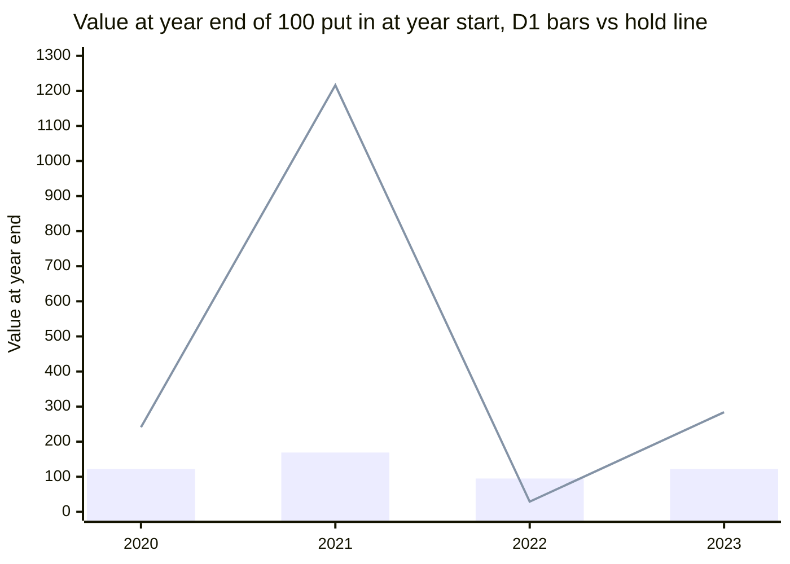
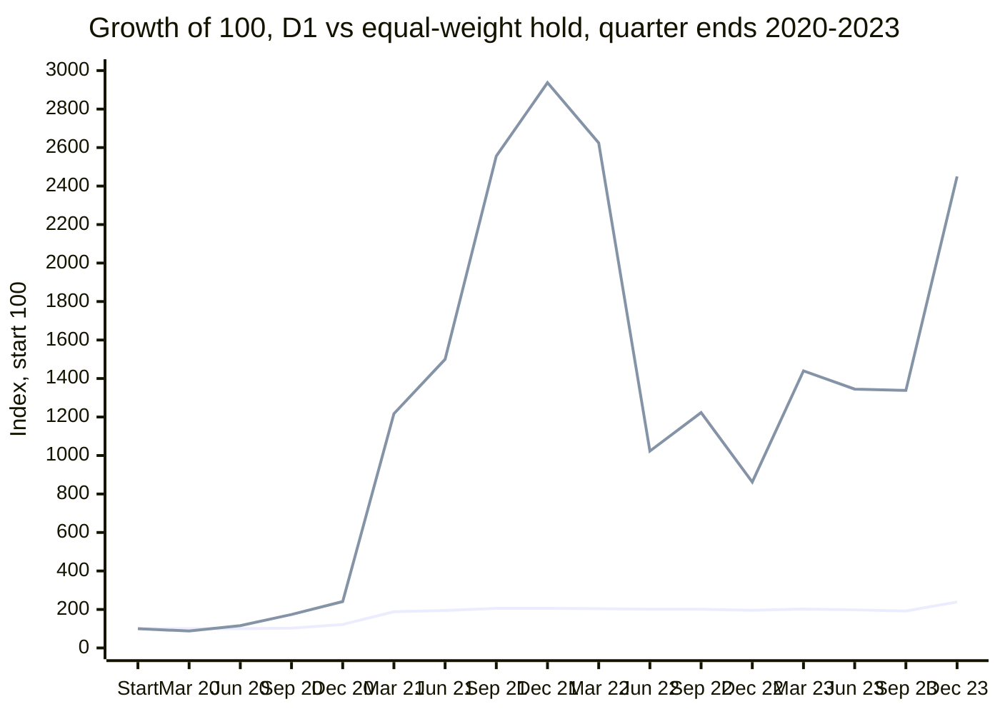
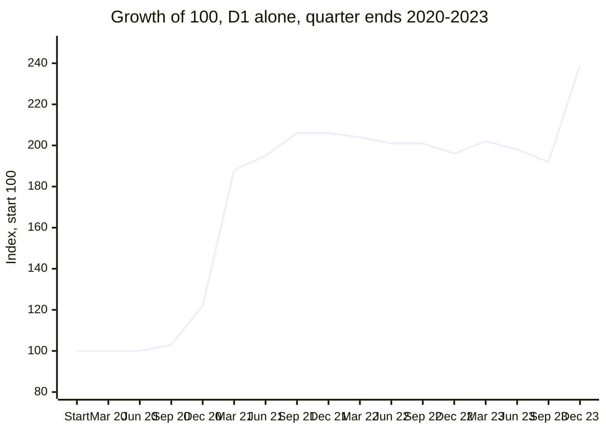
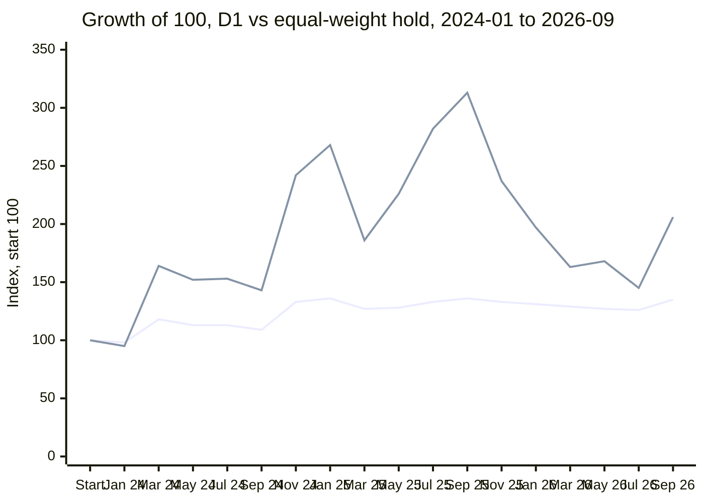
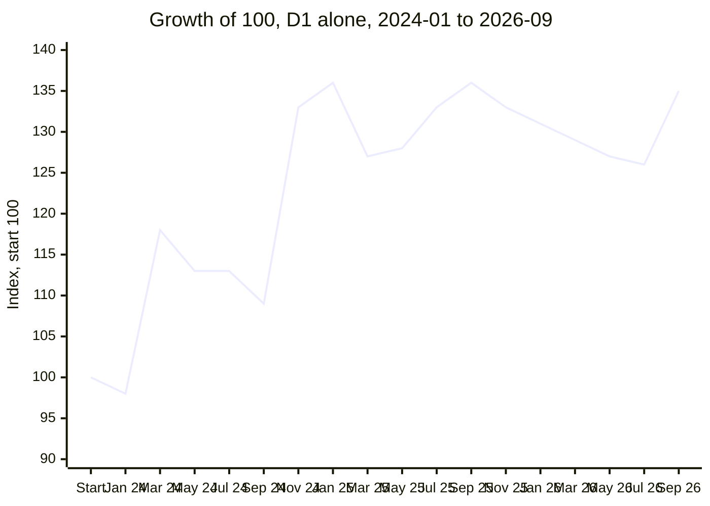

# D1: a daily, long-only trend strategy on 5 Binance perps (Round 5)

> **Summary**
>
> - **What D1 is.** A slow, rule-based trend-following strategy. Once a day it looks at five coins: BTC, ETH,
>   SOL, XRP and BNB (Binance USDT-M perpetual futures). It holds a coin (long only) while that coin is in an
>   uptrend, and sits in cash otherwise. The account is split into 45 small, independent sub-positions:
>   5 coins × 9 trend lengths (5 to 360 days).
> - **Verdict: D1 FAILED its research checks.** Round 5 tested it on 2020–2023 data (the "dev period") against
>   8 checks fixed in advance. It passed 6 and failed 2:
>   - one year (2021) produced 61% of all its profit (the limit was 50%);
>   - it could not be told apart from simply holding a small amount of the coins (alpha PSR 0.884; the bar was 0.95).
> - **What followed.** By the pre-registered rules, the D1 family is closed on these 5 markets. Round 5's rules
>   unlocked none of the 2024–2026 test data (the "holdout"). D1's part of it was later opened once, as information
>   only (last bullet). XS's holdout stays locked.
> - **Now.** At the owner's request, D1 has run on the VPS since 2026-10-17 07:33 UTC as an **information-only paper
>   book**. It sends no orders to Binance and never adds to F1's risk. Its result can never, by itself, make D1 a
>   validated strategy.
> - **2024–2026 (information only).** On 2026-10-18 the owner asked to see D1 on the holdout window anyway. After
>   that request was recorded as Deviation 2, D1 ran once, unchanged, on 2024-01-01 → 2026-09-30 (section 8.5).
>   D1 made **+34.6%** (hold +106.2%), with a Sharpe of **0.92** (hold 0.75) and a worst drawdown of **11.9%**
>   (hold 61.7%). But its alpha PSR was **0.81** (the dev gate's bar was 0.95), and 2024 gave **89%** of its summed
>   daily return (the dev gate's limit was 50%). What it means: D1 stayed positive and fell far less than the coins,
>   but the two measures it failed on got worse. This run cannot make D1 pass, and it changes nothing in the forward
>   test.
>
> Key numbers, dev period 2020-01-01 → 2023-12-31 (1,461 days), after fees, slippage and funding:
>
> | | D1 | Equal-weight hold of the listed perps (all 5 from 2020-09-15) |
> |---|---|---|
> | Total return | +138.8% (\$10,000 → \$23,877) | +2,350% (\$10,000 → \$245,012) |
> | Growth per year (CAGR) | 24.3% | 122.4% |
> | Sharpe ratio | 1.35 | 1.39 |
> | Worst drawdown (end of day) | 19.0% | 79.0% |
> | Beta to the hold / alpha PSR | 0.135 / **0.884** (needed ≥ 0.95) | |
> | Share of profit from the best year | **61%** in 2021 (needed ≤ 50%) | |
> | Activity | 1,304 sub-trades (about 6.2 a week); orders on 64% of days | |
>
> Quick definitions: the *Sharpe ratio* is return per unit of risk, per year (higher is better). A *drawdown* is
> the fall from the highest account value so far to a later low. *Beta* is how much D1 moved with the coins;
> *alpha PSR* is how sure we can be that D1 earned something beyond that (section 7). All terms are in the
> [glossary](#11-glossary).
>
> This is a research record, not financial advice.

## Contents

1. [Summary](#d1-a-daily-long-only-trend-strategy-on-5-binance-perps-round-5) (above)
2. [What D1 is, in plain words](#2-what-d1-is-in-plain-words)
3. [The exact rules](#3-the-exact-rules)
4. [Where it came from and why it was tested](#4-where-it-came-from-and-why-it-was-tested)
5. [How it was tested](#5-how-it-was-tested)
6. [Results (dev period 2020–2023)](#6-results-dev-period-20202023)
7. [Why it failed, in plain words](#7-why-it-failed-in-plain-words)
8. [What was decided](#8-what-was-decided)
   - 8.5 [The 2024-2026 information run (Deviation 2)](#85-the-2024-2026-information-run-deviation-2)
9. [The live shadow paper test](#9-the-live-shadow-paper-test)
10. [Files and how to reproduce](#10-files-and-how-to-reproduce)
11. [Glossary](#11-glossary)

Conventions used in this document:

- All times are UTC. The daily close at 00:00 UTC is 08:00 on the owner's UTC+8 clock.
- "bp" means basis point: 1 bp = 0.01%.
- Every term in *italics* the first time it appears is also explained in the [glossary](#11-glossary).
- Line numbers such as "PREREGISTRATION.md:432" refer to the repository at commit `68c2489`. The Deviation 2
  section (PREREGISTRATION.md:1020-1053) was appended later, in commit `5dd793a`; no earlier line moved.
- Numbers come from `reports/results/D1.json` and the derived tables in `research/D1/results/`, unless another
  source is named.

---

## 2. What D1 is, in plain words

**The idea.** Prices of crypto majors tend to move in trends that last from weeks to months. D1 tries to catch them:

- When a coin's daily closing price breaks **above its recent high**, D1 buys it.
- It keeps holding while the trend lasts.
- It sells when the price falls **below a trailing line** that only moves up.
- It **never shorts**. When there is no uptrend, that part of the money sits in cash (USDT).

This kind of rule is called a *Donchian* breakout, after the "Donchian channel": the highest and lowest close
over the last L days. L is the *lookback*.

**Why 45 sub-positions.** Nobody knows the "right" trend length, so D1 uses nine of them at once:
5, 10, 20, 30, 60, 90, 150, 250 and 360 days (about one week to one year). Each coin × lookback pair is a
separate little strategy, called a *sub-sleeve*:

- 5 coins × 9 lookbacks = **45 sub-sleeves**.
- Each one gets 1/45 of the account and decides on its own: long or flat.
- The account's daily result is the average of the 45.

This makes exposure change gradually. When a trend is just starting, only the fast lookbacks (5, 10, 20 days) are
in. When a trend has lasted many months, the slow ones (150, 250, 360 days) join. When a coin falls, the fast ones
leave first.

**Position size.** Each sub-sleeve buys an amount that would swing about 25% a year, based on how jumpy the coin has
been over the last 90 days (*volatility targeting*). A calm coin gets a bigger position than a wild one. The cap is
2× the sub-sleeve's cash. Size is set once, at entry, and not changed while the position is open.

**How often it trades.** Decisions are made once a day, at the 00:00 UTC daily close. In 2020–2023 it averaged about
6.2 completed sub-trades a week, with at least one order on 64% of days. Most of the time only a part of the account
is invested: on average 14.6 of the 45 sub-sleeves were open, and gross exposure averaged 14.2% of the account.

---

## 3. The exact rules

Source: `research/PREREGISTRATION.md:429-449` (registered rule; the spot warm-up is at 407-411) and
`src/btcq/strategies/r5_d1.py` (code).

### 3.1 Rule table

| Part | Rule |
|---|---|
| Universe | BTCUSDT, ETHUSDT, SOLUSDT, XRPUSDT, BNBUSDT: Binance USDT-M *perpetual futures* ("perps"). Pinned to these 5. |
| Lookbacks L | 5, 10, 20, 30, 60, 90, 150, 250, 360 days (`LOOKBACKS`, r5_d1.py:25). Primary config "all9" uses all nine. |
| Daily close | The last 1-minute close before 00:00 UTC. |
| Entry | When flat: go long if today's close is **strictly above** the highest of the **previous** L closes (today not included). |
| Trailing line | MID_L = (highest + lowest of the last L closes, today included) / 2. At entry the trail is today's MID_L. While long, each day: trail = max(trail, today's MID_L). It never goes down. |
| Exit | When long: go flat if today's close is **strictly below** the trail (the trail is updated with today's MID_L first). |
| Volatility σ | Standard deviation (ddof = 0) of the last 90 daily log returns × √365. |
| Size | At entry only: position value = min(0.25 / σ, 2.0) × the sub-sleeve's own cash. No daily resizing. |
| Signal history | Signals and σ use the coin's daily closes stitched with spot daily closes before the perp's first day (no basis adjustment; gaps of up to 2 days forward-filled), so the L+1 and 91 closes count from the spot history (section 5.2). |
| Ready | A sub-sleeve can trade only when it has L+1 closes and σ exists (91 closes). So the first possible long is at index max(L, 90). |
| Level signals | Entry and exit are level signals: a flat sub-sleeve whose state is long enters at the next fill, and a long one whose state is flat exits. A sub-sleeve already long when the test window starts (or when its perp starts trading) enters at the first decision executed after it (state-synchronous start). |
| Timing | Decide at the 00:00 UTC close. Fill as a *taker* (market order) at the open of the 00:01 minute. |
| Costs | Taker fee 5 bp per side. *Slippage* (the gap between the quoted price and the actual fill) per side: 1 bp for BTC and ETH, 2 bp for SOL, XRP and BNB (`src/btcq/config.py:19-20, 35`). Real historical *funding* per coin (a payment between longs and shorts every 8 hours; longs pay when the rate is positive). |
| Account | 45 sub-sleeves, each 1/45 of the account. Research: account daily return = mean of the 45 sub-sleeve daily returns. |

One-way cost per fill is 6 bp (BTC, ETH) or 7 bp (SOL, XRP, BNB). A round trip costs 12 or 14 bp, plus funding.

### 3.2 What D1 does not do

- No short positions.
- No stop-loss besides the trailing line. (The backtest engine is given a stop at price 0, which can never trigger.)
- No take-profit target and no time limit.
- No daily resizing of an open position.
- No kill switch and no pause. A drawdown does not stop it.
- No netting of orders between sub-sleeves. Each sub-sleeve pays its own fees, which is conservative.
- No coins other than the five above.

### 3.3 How "R" is measured

*R* is a yardstick for one trade: profit divided by the initial risk.

- Initial risk = quantity × (entry fill price − trailing line at entry).
- If that distance is under 0.1% of the price, it is floored at 0.1% (`apply_r`, r5_d1.py:120-132). In the dev run
  this floor was never needed (0 floors).
- Because there is no real stop, a loss can be bigger than 1 R. R is used only to describe trades; the gates use
  daily account returns.

### 3.4 Worked example (BTCUSDT, L = 20; made-up but realistic numbers)

The numbers below are invented, but they were run through the real code (`r5_d1.donchian_state`, the research
engine and the live `D1Book`) and every value matched to a relative tolerance of 1e-12. The sub-sleeve has $222.22
of cash (= $10,000 / 45, as in the live book). The research engine runs each sub-sleeve on its own $10,000: all
ratios are the same, the dollar amounts are 45× larger.

The 20 closes before day 0 (days −20 … −1) are: 57,400 56,800 56,200 57,100 57,900 58,300 58,800 59,400 60,000 59,300
58,600 58,100 57,600 57,900 58,400 58,900 59,200 58,700 59,100 59,600. Assume σ is ready.

**Signal.** On day 0 the close is 60,450. That is above 60,000, the highest of the previous 20 closes, so the state
turns long. The trail starts at MID20 = (60,450 + 56,200) / 2 = 58,325.

| Day | Close | Highest of previous 20 | MID20 → trail |
|---|---|---|---|
| 0 | 60,450 | 60,000 | 58,325 (entry signal) |
| 1 | 61,200 | 60,450 | 58,700 |
| 2 | 62,100 | 61,200 | 59,600 |
| 3 | 61,500 | 62,100 | 59,850 |
| 4 | 63,000 | 62,100 | 60,300 |
| 5 | 64,200 | 63,000 | 60,900 |
| 6 | 65,100 | 64,200 | 61,350 |
| 7 | 64,400 | 65,100 | 61,350 |
| 8 | 63,600 | 65,100 | 61,350 |
| 9 | 64,800 | 65,100 | 61,350 |
| 10 | 66,300 | 65,100 | 61,950 |
| 11 | 65,500 | 66,300 | 61,950 |
| 12 | 64,700 | 66,300 | 62,100 |
| 13 | 63,900 | 66,300 | 62,350 |
| 14 | 62,900 | 66,300 | 62,500 |
| 15 | 62,300 | 66,300 | 62,500 → close is below the trail: **exit signal** |

Notice two things:

- On day 2 the trail jumps, because the old low of 56,200 (day −18) leaves the 20-day window.
- On days 12–14 the trail rises while the price falls. Old lows keep dropping out of the window, so MID20 rises.
  This is how the line "tightens" and ends the trade.

**Size.** σ = 60% a year (daily log-return std 3.1405% × √365). Size = min(0.25 / 0.60, 2) = 0.4167, so the position
is worth 41.67% of the sub-sleeve's cash.

**Entry fill (day 1, 00:01).** The 00:01 open is 60,480. With +1 bp slippage the fill is 60,486.05.

- Quantity = 0.4167 × $222.22 / 60,486.05 = 0.00153081 BTC.
- Position value $92.59 (0.93% of the $10,000 account).
- Entry fee = 0.05% × $92.59 = $0.0463.
- R distance = 60,486.05 − 58,325 = 2,161.05 (3.57% of the price). Initial risk = qty × distance = $3.308.

**Funding.** The position is open for 45 funding settlements (3 a day for 15 days, from day 1 08:00 to day 16 00:00).
At +0.01% each on the position's value at that moment (quantity × the price at the settlement minute, which is how
the engine charges it; here each 08:00 and 16:00 settlement is priced at that day's close and each 00:00 settlement at
the previous day's close), that costs $0.4388. Charged on the entry value instead, it would be
45 × 0.01% × $92.59 = $0.4167.

**Exit fill (day 16, 00:01).** The decision is made at day 15's close. The 00:01 open is 62,250; with −1 bp slippage
the fill is 62,243.78.

- Gross profit = qty × (62,243.78 − 60,486.05) = $2.6907.
- Exit fee $0.0476. Total fees $0.0939.

**Result.**

| Item | $ | In R |
|---|---|---|
| Gross profit | +2.6907 | +0.813 R |
| Fees (both sides) | −0.0939 | −0.028 R |
| Funding | −0.4388 | −0.133 R |
| **Net** | **+2.1580** | **+0.652 R** |

The sub-sleeve made +0.971% on its own cash. The account made +$2.158, or +0.0216% of $10,000. The trade was held
15 days. In this example funding cost almost five times the fees; in the full backtest funding was also the largest
cost (section 6.8).

---

## 4. Where it came from and why it was tested

**Source.** The rule follows Zarattini, Pagani and Barbon (2025), "Catching Crypto Trends"
(PREREGISTRATION.md:430; r5_d1.py docstring).

D1 is not an exact copy of the paper: it sizes each sub-sleeve once at entry, whereas the paper resizes to its
volatility target every day. This is a pre-registered approximation (PREREGISTRATION.md:441-442, 550-551, 561), and
the resulting drift is measured in section 6.9.

**Registered hypothesis** (D1.json): "Time-series momentum at 1-week to 1-year horizons on the 5 majors, expressed
as a 9-lookback daily ensemble that adjusts exposure about once a day."

**Why Round 5 existed** (PREREGISTRATION.md:358-370):

- Round 4 had failed: F1's edge did not carry over to 71 never-used perps, although it held on the 5 majors.
- The owner then wanted about one order a day on the paper bot's 5 markets (BTC, ETH, SOL, XRP, BNB).
- A design review found no evidenced strategy that makes about one independent bet a day after fees. For example,
  a 21–23 UTC "evening long" grosses about 9 bp against a 12–14 bp taker round trip, so it was rejected on arithmetic,
  without using a trial.
- Owner decisions of 2026-10-16:
  - "Daily activity is enough: one order or rebalance a day, even if positions last weeks."
  - Two families would be tested: **D1** (this daily long-only Donchian ensemble) and **XS** (dollar-neutral
    cross-sectional momentum among the 5 coins).
  - Carry and options strategies were out.

**What was already known before the test** (PREREGISTRATION.md:555-565). This matters, because it means D1's
2024–2026 data was not "clean":

- S1 and F1 (4-hour trend strategies) had already been run on these markets, including their holdouts.
- Round 4 had shown that trend works on these 5 majors but not on 71 other perps.
- The general market behaviour of 2024–2026 had been seen.

So the long-only trend idea partly came from data that included 2024–2026. The pre-registration therefore marked
D1's holdout as *contaminated*: information only, never a pass/fail test (PREREGISTRATION.md:470-471).

---

## 5. How it was tested

### 5.1 Pre-registration

*Pre-registration* means writing down the rule, the data, the checks and what each outcome will mean **before**
running the test, and committing it to git so it cannot be changed quietly afterwards.

| Commit / event | Time (UTC) | What |
|---|---|---|
| `7aed2c0` | 2026-10-16 15:58:29 | Round 5 code: `r5_d1.py`, `round5.py`, tests (after fixes from an adversarial review). PREREGISTRATION.md:372 names this commit as the registered code. |
| `e40056a` | 2026-10-16 15:58:40 | Round 5 pre-registration (209 lines) and `research/round5/power_table.csv`. |
| spot download | 2026-10-16 15:59:08 | Spot warm-up data built on `e40056a` (runs.jsonl line 1). |
| `8ca8d7b` | 2026-10-16 15:59:19 | Spot warm-up data report: 0 red flags. |
| `r5-sweep` run | 2026-10-16 16:17:55 | The one dev run, on `8ca8d7b`, clean source tree (runs.jsonl line 2). |
| `8d511ff` | 2026-10-16 16:18:47 | Dev results: "D1 and XS fail; the holdout stays locked". Registry 375 → 384 trials. |
| `a7a7b77` | 2026-10-16 16:30:29 | Outcome note and benchmark wording note (PREREGISTRATION.md:567-583). |
| `68c2489` | 2026-10-17 07:29:34 | Paper bot: D1 shadow book, plus its own pre-registered section (PREREGISTRATION.md:977-1018). |
| deployment | 2026-10-17 07:33 | First minute processed by D1 on the VPS (operator). |

Notes:

- The code was committed 11 seconds before the pre-registration text. The pre-registration names that code commit.
- The code itself refuses to run the sweep unless the committed PREREGISTRATION.md contains the "## Round 5" section
  with its power table (`round5._require_prereg`, round5.py:467-472). It also needs the committed spot report with no
  red flags and a clean `src/` tree.
- The Round 5 section has not been edited since registration. Later commits only appended text.

### 5.2 Data

- **Execution data:** Binance perp 1-minute bars from 2020-01-01, with real per-coin funding. BTC's older spot history
  is never used for trading.
- **Daily close:** the last 1-minute close of each UTC day.
- **Signal warm-up (D1 only):** long lookbacks need up to 360 days of history before the first trade. So, before each
  perp's first day, spot daily closes were stitched on with no basis adjustment (`store.stitch_daily`). BTC used the
  local spot 1-minute history (2017-08 → 2019-12). ETH, XRP, BNB and SOL used Binance's spot daily archive, only up to
  2020-03, 2020-03, 2020-04 and 2020-11, so it never reaches 2024. Gaps of up to 2 days are forward-filled; a longer
  gap stops the run.
- **Red flags** (any one would have stopped the round before any strategy ran): a gap of more than 2 days, a
  non-positive price, a median spot/perp overlap gap ("basis") above 0.5%, or a stitch jump above 1% (or one that
  can't be measured).

Spot warm-up data report (`research/round5/data_report_spot.csv`): **0 red flags.**

| Coin | Spot first day | Perp first day | Spot warm-up days | Days in stitched series (to 2023-12-31) | Overlap days | Median overlap basis | Stitch jump | Longest gap |
|---|---|---|---|---|---|---|---|---|
| BTC (local spot 1m) | 2017-08-17 | 2020-01-01 | 867 | 2,328 | 0 | n/a | −0.081% | 0 |
| ETH | 2017-08-17 | 2020-01-01 | 867 | 2,328 | 91 | 0.068% | −0.115% | 0 |
| SOL | 2020-08-11 | 2020-09-14 | 34 | 1,238 | 78 | 0.121% | +0.061% | 0 |
| XRP | 2018-05-04 | 2020-01-06 | 612 | 2,068 | 86 | 0.115% | −0.224% | 0 |
| BNB | 2017-11-06 | 2020-02-10 | 826 | 2,247 | 81 | 0.091% | +0.169% | 0 |

BTC has no overlap, so its stitch jump was measured on adjacent minutes (spot close 2019-12-31 23:59 vs perp open
2020-01-01 00:00).

### 5.3 Windows

| Window | Dates | Days | Status |
|---|---|---|---|
| *Dev period* | 2020-01-01 → 2023-12-31 | 1,461 | Used for the test. |
| *Holdout* | 2024-01-01 → 2026-09-30 | 1,004 | **Not unlocked by Round 5's rules.** D1's run on it was opened once, as information only, under Deviation 2 (2026-10-18; section 8.5). **Still locked for XS.** |

- The holdout could be unlocked only once, and only if XS passed every dev gate (PREREGISTRATION.md:529-532).
  D1's holdout run would have been information only, inside that unlock.
- XS failed, so Round 5's rules unlocked nothing. At that time `research/holdout_log.jsonl` had 3 lines, and none
  of them was a Round 5 unlock.
- On 2026-10-18 the owner approved Deviation 2 (PREREGISTRATION.md:1020-1053). It added line 4 of the log, the one
  unlock for D1's information run, and lines 5-6, two logged loads by independent checks. XS was not evaluated, so
  XS's holdout stays locked (for how clean it still is, see section 8.5.2).
- Apart from section 8.5, this document read no 2024+ data. Section 8.5 uses the saved Deviation 2 results; two of
  its independent checks loaded the 2024–2026 window after logged unlocks.

### 5.4 Engine, costs and assembly

- Each of the 45 sub-sleeves is its own run of the backtest engine (`src/btcq/backtest/engine.py`) with $10,000 of
  its own cash and a 2× leverage cap.
- **Fills:** decision at the 00:00 daily close; market fill at the open of the first minute at or after 00:01.
  Buy price = open × (1 + slippage); sell price = open × (1 − slippage). The taker fee is charged on both sides.
- **Funding:** real historical rates, charged as qty × price × rate at each settlement minute. On Binance these are
  00:00, 08:00 and 16:00 UTC. A position filled at 00:01 misses that day's 00:00 settlement; a position that exits at
  00:01 pays it. So k days held = 3k settlements.
- **2× cost stress:** fees and slippage doubled; funding unchanged.
- **Account:** the account's daily return is the sum of the 45 sub-sleeve daily returns divided by 45. An idle
  sub-sleeve adds 0. This is the same as rebalancing the 45 slots to equal capital every day. (The live book does
  not do this; see section 9.3.)
- A position still open on 2023-12-31 is closed at the window end (exit reason "end"; 27 trades).

### 5.5 Configurations

| Config | Lookbacks | Sub-sleeves | Role |
|---|---|---|---|
| **all9** | 5, 10, 20, 30, 60, 90, 150, 250, 360 | 45 | **Primary.** The only config that is judged. |
| fast5 | 5, 10, 20, 30, 60 | 25 | Neighbour, used only for PBO and plateau. |
| slow5 | 60, 90, 150, 250, 360 | 25 | Neighbour, used only for PBO and plateau. |

All three are subsets of the same 45 runs. "Its grid is used only for PBO and plateau, never for selection"
(PREREGISTRATION.md:380).

### 5.6 The 8 dev gates (all must pass)

Source: PREREGISTRATION.md:451-468; code `gates_d1`, round5.py:368-378; statistics in `src/btcq/backtest/stats.py`.

| # | Gate | Threshold | What it asks, in plain words |
|---|---|---|---|
| 1 | Weekly t | ≥ 2 | Is the average weekly return clearly above zero, compared with its week-to-week noise? (*t-statistic* of the mean Monday–Sunday compounded weekly return.) |
| 2 | Mean daily return at 2× costs | > 0 | Does it still make money if fees and slippage were twice as high? |
| 3 | Year share | ≤ 50% | Does no single calendar year provide more than half of the summed daily returns? |
| 4 | Coins positive | ≥ 3 of 5 | Do at least 3 coins contribute a positive total? |
| 5 | *PBO* over the 3 configs | ≤ 0.5 | Is choosing the primary config unlikely to be a lucky pick? (CSCV with 16 blocks = 12,870 splits.) |
| 6 | *Plateau* | ≥ 70% | Do the neighbour configs (fast5 and slow5) also make money? With 2 neighbours, both must. |
| 7 | *Alpha* *PSR* vs equal-weight hold | ≥ 0.95 | After removing the part explained by simply holding the 5 coins (*beta*), is the leftover return reliably above zero? |
| 8 | *Circular-shift null*, p | < 0.05 | Does the real timing of the signals beat the same signals slid to random dates? (1,000 draws, seed 55; one random offset of 30+ days shared by all coins and lookbacks; full re-simulation through the engine; statistic = mean daily net return.) |

Reported but **not** gated for D1: the *DSR* (Deflated Sharpe Ratio), which asks whether the Sharpe ratio beats what
the luckiest of many no-edge strategies would show, given how many strategies this project has tried. D1 has no
trade-count, profit-factor or DSR gate. The general gates at PREREGISTRATION.md:28-40 belong to rounds 1–3.

The "equal-weight hold" benchmark in gate 7 is, in the code, the daily-rebalanced average of the daily
close-to-close returns of the perps listed that day, without funding (`round5.ew_benchmark`): BTC and ETH from
2020-01-02, XRP from 2020-01-07, BNB from 2020-02-11, all 5 only from 2020-09-15 (258 of the 1,461 dev days, all in
2020, have fewer than 5 coins). The pre-registration text called it "buy-and-hold";
the wording note at PREREGISTRATION.md:581-583 records the difference (section 7.3).

### 5.7 Verdict words

Round 5 changed the verdict rules (owner decision 2026-10-16, made after every DSR test in rounds 1–4 had failed;
PREREGISTRATION.md:374-381):

- **REPLICATED:** a family passes its dev gates and then its one-shot holdout gates.
- **STRICT:** REPLICATED plus DSR ≥ 0.95 on dev + holdout daily returns, at N = max(ratcheted N_eff, 14.85 + 2).
- The change relaxes Round 4's rule, which also required PSR(0) ≥ 0.95. It applies to Round 5 only.

For D1 the holdout is contaminated, so D1 had **no** path to REPLICATED or STRICT. The best D1 could get was
"dev passed: shadow sleeve", meaning a zero-risk paper sleeve next to F1 (PREREGISTRATION.md:473-474). Otherwise:
"failed dev".

### 5.8 Power table

*Power* is the chance that a test passes a strategy that really works. Before the run, a simulation estimated it
(`research/round5/power_table.csv`; random daily returns with 1% daily volatility, 40,000 simulations, seed 5):

| True yearly Sharpe | P(dev pass) | P(REPLICATED) | P(STRICT) |
|---|---|---|---|
| 0.0 (no edge) | 2.4% | 0.41% | 0.02% |
| 0.5 | 15.7% | 6.8% | 1.2% |
| 0.75 | 31.0% | 17.3% | 4.9% |
| 1.0 | 49.9% | 34.2% | 16.0% |
| 1.25 | 68.8% | 54.0% | 34.6% |
| 1.5 | 83.8% | 71.8% | 57.8% |
| 2.0 | 97.7% | 91.5% | 89.3% |

How to read it:

- A strategy with no edge would pass the weekly-t gate only about 2.4% of the time.
- A strategy with a true Sharpe of 1.0 would pass only about half the time. The test is strict on purpose.
- The table models only the weekly-t gate (and XS-style holdout gates). D1's other gates (year share, alpha PSR,
  null, and so on) make passing harder still. So these are upper bounds.

### 5.9 Trial registry and N_eff

- Every strategy variant ever run on dev data is a *trial* in `research/trials.csv`. Round 5 added 9 (D1 × 3,
  XS × 6), taking the registry from 375 to 384 trials. A rerun needs a version bump and adds new trials
  (round5.py:563-569).
- Many trials are similar, so the number of truly independent tries, *N_eff*, is much smaller. It is estimated by a
  "participation ratio" (`research/neff_history.jsonl`). Round 5's raw value was 11.81 over 384 series.
- *Ratchet* rule (Amendment 2): N_eff never goes down. The highest value ever recorded is 14.85 (round 1), so that
  is used.
- The DSR for Round 5 uses N = 14.85 + 2 = 16.85 ("+2" for the two new families).

D1's three trial rows (trials.csv lines 377-379, all on 1,461 dev days):

| Config | Annual Sharpe | Skew | Kurtosis | Trades |
|---|---|---|---|---|
| all9 | 1.352 | 0.62 | 44.65 | 1,304 |
| fast5 | 1.649 | 1.84 | 35.68 | 1,201 |
| slow5 | 1.047 | −0.94 | 60.54 | 162 |

---

## 6. Results (dev period 2020–2023)

All results are for the primary config (all9) after fees, slippage and funding, unless a row says otherwise.

### 6.1 Headline

| Metric | D1 | Equal-weight hold |
|---|---|---|
| Total return | +138.8% | +2,350.1% |
| End value of $10,000 | $23,877 | $245,012 (from `monthly_equity.csv`) |
| CAGR (growth per year) | 24.3% | 122.4% |
| Sharpe (yearly) | 1.352 | 1.393 |
| Sortino | 1.54 | |
| Max drawdown, end of day | 18.98% | 79.05% |
| Calmar (CAGR / max drawdown) | 1.28 | |
| Longest time under water | 954 days | |
| Yearly volatility of daily returns | 17.2% | |
| Positive years | 3 of 4 | 3 of 4 |
| Daily correlation with the hold | 0.650 | |
| Beta to the hold | 0.135 | |
| Alpha (after beta) | 7.7% a year, Sharpe 0.59 | |
| Weekly t | 2.49 (209 weeks; mean +0.45% a week, sd 2.62%) | |
| PSR(0), chance the true Sharpe > 0 | 0.996 | |
| DSR at N = 16.85 (reported only) | 0.809 | |

D1's worst drawdown: equity peaked at $23,608 on 2021-05-11, fell to $19,127 on 2023-10-18, and recovered on
2023-12-22. That is the 954-day spell under water.

### 6.2 Gates: 6 pass, 2 fail

| Gate | D1 value | Threshold | Result |
|---|---|---|---|
| Weekly t | 2.486 | ≥ 2 | PASS |
| Mean daily return at 2× costs | 0.000627 (0.063% a day) | > 0 | PASS |
| **Year share** | **0.610 (2021)** | ≤ 0.50 | **FAIL** |
| Coins positive | 5 of 5 | ≥ 3 | PASS |
| Shift null p | 0.009 (8 of 1,000 draws ≥ actual) | < 0.05 | PASS |
| PBO | 0.103 | ≤ 0.5 | PASS |
| Plateau | 1.0 (both neighbours positive) | ≥ 0.7 | PASS |
| **Alpha PSR vs equal-weight hold** | **0.884** | ≥ 0.95 | **FAIL** |

**dev_pass = false.** The DSR of 0.809 is also below 0.95, but it is not a D1 gate.

### 6.3 Year by year

"Hold" is the daily-rebalanced equal-weight average of the perps listed that day, close-to-close, without funding
(`round5.ew_benchmark`): BTC and ETH from 2020-01-02, XRP from 2020-01-07, BNB from 2020-02-11, all 5 from
2020-09-15. "Share of summed daily" is the gated year-share measure: the year's sum of daily returns divided by the
4-year total (0.929).

| Year | D1 return | Hold return | D1 worst drawdown within the year (from that year's own high) | Hold worst drawdown within the year (from that year's own high) | Share of summed daily (gate) | Share of trade R | Trades entered | D1 Sharpe | Hold Sharpe |
|---|---|---|---|---|---|---|---|---|---|
| 2020 | +21.96% | +141.45% | 6.62% | 60.4% | 22.4% | 42.7% | 313 | 1.48 | 1.48 |
| 2021 | +69.14% | +1,116.2% | 17.76% | 54.2% | **61.0%** | 39.9% | 312 | 1.98 | 2.96 |
| 2022 | −5.16% | −70.65% | 5.31% | 71.7% | −5.6% | −8.0% | 297 | −1.25 | −1.13 |
| 2023 | +22.04% | +184.24% | 7.27% | 27.3% | 22.2% | 25.4% | 382 | 1.75 | 2.28 |
| 2020–2023 | +138.77% | +2,350.1% | 18.98% | 79.05% | 100% | 100% | 1,304 | 1.35 | 1.39 |

The yearly drawdowns are measured from each year's high, so the 18.98% drawdown from the 2021-05-11 peak (low on
2023-10-18) shows only in the total row. From the all-time peak, D1 was down up to 17.1% in 2022 and 19.0% in 2023.

The chart below shows what 100 put in at the start of each year was worth at the end of that year. Bars are D1,
the line is the equal-weight hold. Below 100 means a losing year. (Data: `results/chart_points.csv`.)



What it shows: D1 lost little in the 2022 bear market (95 vs 29 for the hold), but in every up year it made much
less than holding the coins.

The next chart shows the growth of 100 over the whole dev period, sampled at quarter ends (17 points). The hold's
highest month-end value, 3,587 at the end of 2021-11, falls between two samples. The line that climbs to about 2,900
is the hold; the line that stays near the bottom is D1. (Data: `results/monthly_equity.csv`, sampled in
`results/chart_points.csv`.)



On that scale D1 looks flat, so here is D1 alone, same points:



Most of D1's gain came between late 2020 and spring 2021. From mid-2021 to autumn 2023 it moved sideways to down.

### 6.4 By coin

"Contribution" is the sum of the coin's 9 sub-sleeve daily returns divided by 45. The five add up to 0.929, the
account's summed daily return. "Perp hold return" is the coin's own price change over the dev period.

| Coin | Trades | Win rate | Avg R | Avg hold (days) | Contribution | Share of total | Perp hold return over dev |
|---|---|---|---|---|---|---|---|
| BTC | 286 | 36.7% | 1.08 | 19.6 | 0.145 | 15.6% | +488% |
| ETH | 287 | 45.6% | 0.95 | 18.3 | 0.173 | 18.6% | +1,648% |
| SOL | 196 | 43.9% | 2.46 | 17.2 | 0.287 | 30.9% | +3,016% (from 2020-09-14) |
| XRP | 269 | 30.9% | 0.61 | 11.5 | 0.055 | 6.0% | +177% |
| BNB | 266 | 40.2% | 1.78 | 15.3 | 0.268 | 28.9% | +1,136% |

All 5 coins were positive. SOL and BNB gave 60% of the result together. SOL was also the coin that rose most
(+3,016%); BNB rose third-most (+1,136%), behind ETH (+1,648%). XRP, the coin that rose least, gave the least.

### 6.5 By lookback

"Stand-alone" means the 5 sub-sleeves of that lookback run as their own 5-coin account.

| L (days) | Trades | Win rate | Avg R | Avg hold (days) | Median hold (days) | Contribution | Share | Stand-alone total return | Stand-alone Sharpe |
|---|---|---|---|---|---|---|---|---|---|
| 5 | 582 | 36.8% | 0.79 | 4.6 | 4 | 0.091 | 9.8% | +120.6% | 1.64 |
| 10 | 307 | 37.8% | 1.15 | 8.7 | 7 | 0.103 | 11.1% | +142.7% | 1.60 |
| 20 | 153 | 44.4% | 1.45 | 17.3 | 13 | 0.111 | 11.9% | +156.5% | 1.52 |
| 30 | 100 | 49.0% | 2.05 | 26.5 | 26 | 0.118 | 12.7% | +172.7% | 1.54 |
| 60 | 59 | 39.0% | 3.35 | 45.9 | 40 | 0.137 | 14.7% | +208.1% | 1.34 |
| 90 | 44 | 34.1% | 2.54 | 55.0 | 44 | 0.107 | 11.5% | +135.5% | 1.04 |
| 150 | 31 | 41.9% | 1.91 | 70.3 | 52 | 0.085 | 9.1% | +93.7% | 0.86 |
| 250 | 16 | 43.8% | 3.07 | 116.8 | 61.5 | 0.091 | 9.7% | +104.6% | 0.92 |
| 360 | 12 | 58.3% | 3.64 | 130.1 | 74.5 | 0.087 | 9.4% | +99.6% | 0.92 |

Every lookback made money on its own. The fast ones trade far more often; the slow ones trade rarely but hold long.

Coin × lookback contribution to the account's summed daily return, in percent of the account (each cell is the
sub-sleeve's summed daily return ÷ 45, × 100; the 45 cells add up to 92.9, the 0.929 total; divide a cell by 0.929 to
get its share of the total) (from `results/coin_x_lookback_contribution.csv`):

| Coin | 5 | 10 | 20 | 30 | 60 | 90 | 150 | 250 | 360 |
|---|---|---|---|---|---|---|---|---|---|
| BTC | 1.8 | 1.5 | 1.5 | 2.1 | 2.3 | 1.7 | 1.1 | 1.3 | 1.3 |
| ETH | 1.2 | 1.4 | 2.3 | 2.1 | 1.8 | 1.9 | 1.7 | 2.4 | 2.6 |
| SOL | 2.7 | 2.7 | 3.7 | 4.1 | 5.5 | 3.9 | 2.9 | 1.8 | 1.3 |
| XRP | 1.3 | 2.2 | 1.3 | 1.2 | 0.6 | 0.2 | −0.3 | −0.4 | −0.5 |
| BNB | 2.1 | 2.5 | 2.3 | 2.3 | 3.6 | 3.0 | 3.1 | 4.0 | 4.0 |

Only 3 of the 45 cells are negative: XRP at 150, 250 and 360 days.

### 6.6 Trade statistics

| Statistic | Value |
|---|---|
| Completed sub-trades | 1,304 (all long; about 326 a year) |
| Wins / losses | 512 / 792 (win rate 39.3%) |
| Average win / average loss | +5.24 R / −1.24 R |
| Average R / median R | +1.31 R / −0.51 R |
| Profit factor (in R) | 2.74 |
| Total R | 1,702.5 |
| Trade t-statistic | 6.86 (optimistic: trades overlap in time, so they are not independent) |
| Holding time | average 16.4 days, median 6.5, min 1, max 302 |
| Longest winning / losing streak (in exit order) | 26 / 35 |
| Exit reasons | trailing-line exit 1,277; still open at 2023-12-31 ("end") 27; stop 0 |
| Best trade by R | BNB L=5, 2021-01-29 → 2021-02-16: +107.5 R, +1.42% of the account |
| Worst trade by R | BTC L=5, 2022-08-26 → 2022-08-27: −23.8 R, but only −0.047% of the account (the entry was very close to the trail, so 1 R was tiny) |
| Best trade by account return | BNB L=250 and L=360 (identical trades), 2020-09-13 → 2021-05-20: +6.07% of the account each (+25.6 R) |
| Worst trade by account return | XRP L=360, 2020-11-22 → 2020-12-24: −0.29% of the account |
| R floors used / engine-vs-rule mismatches | 0 / 0 |

The typical pattern of trend following shows clearly: most trades lose a little (median −0.51 R), a few win a lot
(average win 5.24 R).

### 6.7 Activity

| Measure | Value |
|---|---|
| Completed sub-trades per week | 6.25 |
| Days with at least one order | 64.0% |
| Netted orders per day (one per coin per day with any change) | 1.30 |
| Un-netted sub-sleeve orders per day | 1.79 |
| Open sub-positions | average 14.6 of 45; maximum 42 (2021-04-06); none open on 10.1% of days |
| Open sub-positions by year (average) | 2020: 14.9 · 2021: 20.8 · 2022: 5.9 · 2023: 16.9 |
| Sub-sleeve fills on an active day | median 2, 95th percentile 7, maximum 19 (2023-07-14), not counting the 27 forced closes at the window end; 29 on 2023-12-31 if they are counted |
| Mean gross exposure | 14.2% of the account |
| Days with exactly 0 return | 8.35% |

Trades per week by lookback: 5 days 2.79, 10 days 1.47, 20 days 0.73, 30 days 0.48, 60 days 0.28, 90 days 0.21,
150 days 0.15, 250 days 0.08, 360 days 0.06.

### 6.8 Costs and funding

Summed over all trades, in account-return units (each trade's amount divided by its sub-sleeve equity at entry,
then divided by 45):

| Item | Account-return units | Dollars, as % of the $10,000 start |
|---|---|---|
| Gross profit (after slippage, which is inside the fill prices) | 1.4405 | 172.85% |
| Fees | −0.0107 | −1.75% |
| Funding paid | −0.3115 | −33.83% |
| **Net** | **1.1182** | |
| Slippage (estimate) | 0.0032 | |

- **Funding was by far the largest cost.** In account-return units it was about 29× the fees (0.3115 vs 0.0107);
  in dollars about 19× (33.83% vs 1.75%). Long positions in a rising market usually pay funding, and D1 holds for
  weeks, paying three times a day.
- Per trade, fees averaged 0.030 R and funding 0.263 R.
- Doubling fees and slippage cost 0.0133 of summed daily return over the 4 years.

Note: 1.118 (summed trade returns) is not the same number as 0.929 (summed daily account returns). Trade returns are
measured against the sub-sleeve's equity at entry; daily returns are marked to market every day. The official
per-coin and per-lookback figures use the daily contribution.

### 6.9 Stress tests and robustness

| Check | Result | Comment |
|---|---|---|
| 2× fees and slippage | mean daily 0.000627 (vs 0.000636); total +135.6%; Sharpe 1.33 | Costs are small next to the result. Passes gate 2. |
| Circular-shift null | actual 0.000636 a day (23.2% a year ×365); null average 0.000272 (9.9% a year); null 95th percentile 0.000514; 8 of 1,000 draws ≥ actual; p = 0.009 | The real signal timing beat randomly shifted timing. See the caveat below. |
| PBO (3 configs, 12,870 splits) | 0.103 (median logit 1.10) | Low chance that all9 is a lucky pick among the three. |
| Plateau | fast5 +161.6%, slow5 +126.0% | Both neighbours positive. |
| DSR (reported only) | 0.809 at N = 16.85; Sharpe needed to beat luck ≈ 0.91 | Below 0.95: after accounting for the number of strategies tried in this project, the Sharpe of 1.35 is not convincing on its own. |
| Exposure tracking (entry-only sizing vs the paper's daily resizing) | ratio of actual to target exposure: mean 1.23, median 1.05, 5th–95th percentile 0.80–2.86; 9.3% of days outside 0.5–2 | Entry-only sizing is close to the paper's daily resizing most of the time, but drifts on some days. |
| Trade-sequence bootstrap (10,000 sims) | total return 5th/50th/95th percentile 95% / 196% / 378%; max drawdown 2.0% / 3.1% / 5.2% | Not used for any decision. It ignores that trades overlap, so it is too optimistic, and its drawdowns are far below the real 19%. |

**Caveat on the null test (from Round 6).** Round 6 (PREREGISTRATION.md:869-875) found, on synthetic data, that this
style of null ("re-simulate shifted states through the engine") is biased: shifted fixed-size positions have no
price-based exit, so they can lever into bad moves. It captured only about 80% of a drift's effect and rejected
7–9% of the time at a nominal 5% when there was no edge. D1's null uses the same design. D1's p = 0.009 has **not**
been re-evaluated. This is a caveat, not a change to the recorded result.

### 6.10 The three configs

| Config | Trades | Total return | CAGR | Sharpe | Max DD | Weekly t | Year share | Alpha PSR | Beta |
|---|---|---|---|---|---|---|---|---|---|
| **all9 (primary)** | 1,304 | +138.8% | 24.3% | 1.352 | 18.98% | 2.486 | 0.610 | 0.884 | 0.135 |
| fast5 (5–60) | 1,201 | +161.6% | 27.2% | 1.649 | 11.86% | 3.052 | 0.549 | 0.979 | 0.122 |
| slow5 (60–360) | 162 | +126.0% | 22.6% | 1.047 | 33.41% | 1.939 | 0.695 | 0.711 | 0.155 |

- fast5 and slow5 share L = 60 (59 trades), so 1,201 + 162 − 59 = 1,304.
- `reports/results/D1_configs.csv` holds only all9. The fast5 and slow5 rows were computed from
  `D1_trial_returns.parquet` and the trades, and checked against trials.csv.
- fast5 looks better on paper, but it was **not** the registered config. Picking it after seeing results would be
  exactly the kind of selection the pre-registration forbids. It would also have failed the year-share gate (0.549).

### 6.11 Verification

- PREREGISTRATION.md:579-580: three independent rebuilds from raw dev data, written without project code, reproduced
  every trade and gate value.
- For this document, D1 was re-run on dev data only with the project code. The daily returns and equity matched
  `D1_dev_daily.parquet` and `D1_dev_equity.parquet` exactly (difference 0.0); all 1,304 trades matched; 100 of 100
  checked numbers matched D1.json, D1_configs.csv, trials.csv and D1_dev_dists.npz (largest difference 7e-15).
- Since the results commit `8d511ff`, `r5_d1.py` and `engine.py` have not changed. `stats.py` only gained a new
  function (`power_table_td`). `round5.py` changed once, in `5dd793a` (Deviation 2): it gained the `r5-d1-info`
  command (`preflight_d1_info`, `cmd_d1_info`), and `d1_evaluate` now also returns each sub-sleeve's results so they
  can be saved. The dev evaluation is otherwise unchanged.

### 6.12 Numbers that are easy to mix up

- **Two "year share" numbers.** The gated one is 0.610 (summed daily returns, year 2021). D1.json's
  `summary.max_year_share` is 0.427 (trade R grouped by entry year, year 2020). Only the first is the gate.
- **Two "exposure" numbers.** `summary.exposure` = 14.63 is a count of open sub-positions out of 45 (time-weighted
  by minute). `mean_gross_exposure` = 0.142 is position value as a share of the account.
- **Orders per day.** D1.json has no "orders per day" key. The 1.30 figure uses the live bot's definition (one per
  coin per day with any entry or exit).

---

## 7. Why it failed, in plain words

### 7.1 It behaved mostly like a small, switched-on/switched-off holding of the coins

- Over 2020–2023 the equal-weight hold of the coins grew to about 24.5 times its starting value (+2,350%). D1 made
  +139%.
- D1's daily returns had a correlation of 0.65 with the hold. When D1 is in, it moves with the coins.
- But D1 was only partly invested: average gross exposure was 14.2% of the account. That is why its *beta* is small
  (0.135): on average, a 1% move of the hold moved D1 by about 0.135%.
- Gate 7 asks: after removing that beta part, is anything left? The leftover (alpha) was 7.7% a year, with a Sharpe
  of 0.59.
- *PSR* then asks how sure we can be that the true alpha is above zero, given 1,461 days and how bumpy the returns
  are. The answer was **0.884**. In other words, there was roughly a 12% chance of seeing alpha this good from a
  strategy with no real alpha. The pre-registered limit was 5% (PSR ≥ 0.95).
- Also note: D1's Sharpe (1.35) was slightly *lower* than simply holding the 5 coins (1.39) over the same years.
  Its main advantage was the much smaller drawdown (19% vs 79%), and part of that simply comes from holding less.

### 7.2 One year did most of the work

- 2021 produced 61% of D1's summed daily returns. The limit was 50%.
- 2020 and 2023 gave about 22% each; 2022's share was about −5.6% (D1 itself returned −5.16% in 2022).
- The gate exists because a strategy that depends on one exceptional year (here the 2021 bull run) may not repeat it.
  With only 4 years of data, one big year can make a weak rule look strong.

### 7.3 Would a different benchmark have changed it?

No. The code's benchmark is a daily-rebalanced equal-weight average of the perps listed on each day (BTC and ETH
until XRP lists on 2020-01-06; BNB lists on 2020-02-10 and SOL on 2020-09-14; each joins with its first
close-to-close return the next day, so all 5 are in only from 2020-09-15), without funding. The pre-registration text called it "buy-and-hold". Literal buy-and-hold versions give an alpha PSR of 0.909–0.929, which also fails, and D1 fails the
year-share gate independently (PREREGISTRATION.md:581-583).

### 7.4 What D1 did show

To be fair to it: D1 passed weekly t (2.49), the shift null (p 0.009, with the caveat in 6.9), PBO (0.10), plateau,
2× costs, and all 5 coins were positive. It lost only 5% in the 2022 bear market. These are real features of the
backtest. They were not enough, under the rules fixed in advance, to show an edge beyond riding the coins' rise.

---

## 8. What was decided

These consequences were written down **before** the run (PREREGISTRATION.md:473-474, 534-540) and applied after it
(PREREGISTRATION.md:567-583):

- "**Any FAIL:** that family is closed on these markets." D1 failed, so the D1 family is closed on BTC, ETH, SOL,
  XRP and BNB.
- XS failed too (PBO 0.578, weekly correlation with F1 0.441, HAC alpha t 1.41). So "nothing passes" applied:
  **F1 stays alone, and the 1-trade-a-day target is retired for these 5 markets.**
- No holdout was unlocked under Round 5's rules. (Two days later, D1's window was opened once as information under
  Deviation 2; see section 8.5. XS's holdout stays locked.)
- Round 5's result did not trigger the bot work that only a pass would have started (a daily/weekly scheduler and
  netted per-market targets for a real sleeve). The shadow book added later at the owner's request (`68c2489`,
  section 9) does run D1's daily decisions inside the paper bot, but un-netted, on paper only and for information
  only.
- Had D1 passed, it would have become a zero-risk shadow sleeve; it could replace F1 only by owner decision after at
  least 12 months of shadow running, and it would never stack on F1.

Later context:

- Round 6 (`7c6f725`) counts D1 as one of the families tried after Round 4 when setting N for STRICT.
- Round 6's rule M1 adapted D1's Donchian-ensemble rule (the same 9 lookbacks, MID_L trail and min(0.25/σ, 2) entry
  sizing) to 11 Binance TradFi perps, but traded long and short, on trading days with σ × √252, and was tested on
  Yahoo/EIA daily proxies for 1986–2015 (PREREGISTRATION.md:705-719). It also failed dev (commit `d4cb213`: "M1 fails
  8 of 9 gates").
- On 2026-10-17 the owner asked to run D1 on the paper bot anyway, as information only. That is section 9.
- On 2026-10-18 the owner asked to see D1 on the 2024–2026 holdout window too, as information only (Deviation 2).
  That is the next section, 8.5.

---

### 8.5 The 2024-2026 information run (Deviation 2)

> **In short.** On 2026-10-18 the owner asked to see D1 on Round 5's holdout window, 2024-01-01 → 2026-09-30,
> although D1 had already failed. The request was written down and committed first (Deviation 2). Then D1 ran once,
> unchanged. D1 made +34.6% with a worst drawdown of 11.9%. Holding the 5 coins made +106.2% with a worst drawdown of
> 61.7%. The two measures D1 failed on in dev got worse: alpha PSR 0.812 (the dev gate's bar was 0.95) and year
> share 0.894 (the dev gate's limit was 0.50). The run is information only. **It cannot make D1 pass Round 5, and
> it does not change the forward test.**

Sources for this section:

- `reports/results/D1.json`, key `holdout` (written by the run), and the run's result files
  `reports/results/D1_holdout_*.parquet` (section 10.2).
- The derived tables `research/D1/results/holdout_*.csv` (section 10.3).
- Three independent checks (section 8.5.10). Numbers that only a check produced say so.

"Hold" means equal amounts of the 5 perps, rebalanced at every daily close, without funding. It is Round 5's
benchmark (`round5.ew_benchmark`). All 5 perps traded for the whole window.

#### 8.5.1 Why it ran

- D1 failed Round 5's dev gates (section 6.2). Its holdout had been registered as contaminated: information only,
  and run only inside an XS unlock. XS failed, so Round 5's rules opened nothing (section 8).
- On 2026-10-18 the owner asked to see D1 on 2024–2026 anyway, "as the most relevant years", accepting that this is
  outside the registered rules (PREREGISTRATION.md:1020-1024).
- The request was recorded as **Deviation 2** (PREREGISTRATION.md:1020-1053) and committed **before any 2024+ data
  was loaded**. That text fixed what runs, what must be reported, and what the result can and can't mean.

| Commit / event | Time (UTC) | What |
|---|---|---|
| `5dd793a` | 2026-10-18 13:48:36 | Deviation 2 text, the `r5-d1-info` command (`round5.cmd_d1_info`) and its test (`test_d1_info_run_needs_the_committed_deviation_runs_once_and_leaves_xs_alone`). |
| unlock | 2026-10-18 13:48:51 | `research/holdout_log.jsonl` line 4, tag `[R5 D1-info: D1 only, information; XS stays locked]`. 15 seconds after the commit. |
| `r5-d1-info` run | 2026-10-18 13:49:07 | `research/round5/runs.jsonl` line 3: git `5dd793a`, clean tree. |
| check unlock | 2026-10-18 13:51:45 | holdout_log line 5, `[R5 D1-info verify resim]` (independent re-simulation). |
| check unlock | 2026-10-18 13:53:29 | holdout_log line 6, `[R5 D1-info verify context]` (benchmark and context check). |

What Deviation 2 said must be reported (PREREGISTRATION.md:1037-1046), and where to find it:

| Required item | Section |
|---|---|
| Total return, CAGR, Sharpe, worst end-of-day drawdown, weekly t | 8.5.3 |
| Beta and alpha PSR against the equal-weight hold | 8.5.3 |
| D1 and the hold for each year (2024, 2025, 2026 to 30 September), and the year share | 8.5.4 |
| Results per coin and per lookback | 8.5.5, 8.5.6 |
| Activity, fees and funding | 8.5.7 |
| The account added up the live way (each sub-sleeve keeps its own cash, no rebalancing) | 8.5.8 |
| Reference yardsticks (not gates) | 8.5.9 |

#### 8.5.2 What ran

- **The rule: unchanged.** The registered rule and primary config (all9), with Round 5's code and costs (section 3).
  `r5_d1.py` and the engine have not changed since the dev results. `5dd793a` only added the command to `round5.py`
  and made `d1_evaluate` also return each sub-sleeve's results, so they could be saved.
- **The window:** 2024-01-01 → 2026-09-30, 1,004 days (Round 5's holdout). Signals use the earlier history as usual.
- **One main engine run per sub-sleeve, plus the 2× cost stress.** `d1_evaluate` always makes the stress run, so
  every sub-sleeve was run a second time at 2× fees and slippage. Deviation 2's text says "one engine run per
  sub-sleeve and no shift null"; the stress run is the one run beyond that. The circular-shift null was not run, so
  there is no p-value.
- **One logged unlock**, made by `python -m btcq.research.run r5-d1-info --unlock-holdout`. The command refuses to
  run a second time (section 10.2).
- **XS was not evaluated.** XS's holdout stays locked. Deviation 2 called it "locked and clean". Note, though, that
  this document now gives each coin's measured 2024–2026 price change (section 8.5.5). That adds to Round 5's
  disclosed general knowledge of the period's relative moves (PREREGISTRATION.md:523-524) for any later test of XS,
  or of XS-like ideas, on these coins.
- **Not a new trial.** `research/trials.csv` and `research/neff_history.jsonl` are unchanged.
- **Start of the window.** The start is state-synchronous (section 3.1): the 26 sub-sleeves already long on the
  2023-12-31 decision all entered at 2024-01-01 00:01.
- **End of the window.** The 26 positions still open were closed at the 2026-09-30 23:59 close × (1 − slippage),
  with the 5 bp taker fee, and booked on the last day (exit reason "end"). This end-of-window convention cost about
  0.03 percentage points of total return (section 8.5.10).
- **Integrity:** 0 R floors and 0 engine-vs-rule mismatches (D1.json).
- D1.json labels the result: `holdout_status` = "contaminated: information only (owner-approved Deviation 2, run
  after D1 failed dev)".

#### 8.5.3 Headline: D1 vs the hold

Research account (rebalanced daily, as in section 6), after fees, slippage and funding. Sources: D1.json `holdout`
and `results/holdout_headline.csv`; the hold's volatility comes from the context check.

| Metric | D1 | Equal-weight hold |
|---|---|---|
| Total return | +34.56% (\$10,000 → \$13,456) | +106.17% (\$10,000 → \$20,617) |
| CAGR (growth per year) | 11.40% | 30.09% |
| Sharpe (yearly) | 0.916 | 0.748 |
| Sortino / Calmar | 1.12 / 0.96 | |
| Yearly volatility of daily returns | 12.65% | 56.4% |
| Worst drawdown, end of day | 11.87% | 61.68% |
| When | peak 2025-10-08 (\$14,260), low 2026-08-06 (\$12,567); not recovered by 2026-09-30, when D1 was still 5.6% below the peak | peak 2025-10-06, low 2026-06-25; not recovered by 2026-09-30 |
| Longest time under water | 357 days | |
| Positive years | 3 of 3 | 1 of 3 |
| Days with exactly 0 return | 6.87% | |
| PSR(0), chance the true Sharpe > 0 | 0.935 | |
| Weekly t | 1.47 (144 weeks; mean +0.22% a week, sd 1.82%) | |
| Daily correlation with the hold | 0.761 | |
| Beta to the hold | 0.171 | |
| Alpha (after beta) | 4.38% a year, Sharpe 0.53 | |
| **Alpha PSR vs the hold** | **0.812** (dev 0.884; the dev bar was 0.95) | |
| **Year share** | **0.894, year 2024** (dev 0.610; the dev limit was 0.50) | |

Other reference points over the same 1,004 days (context check, from daily closes, without funding):

| | Total return | Sharpe | Worst drawdown |
|---|---|---|---|
| BTC perp alone | +97.5% | 0.76 | 53.0% (2025-10-06 → 2026-06-30) |
| A fixed 17.1% of the account in the hold (D1's beta), the rest in cash | +20.4% | 0.75 | 13.7% |
| A fixed 22.4% in the hold (D1's volatility), the rest in cash | +26.9% | | 17.7% |

D1 beat both fixed mixes. (In dev, the beta-matched mix, 13.5% in the hold, made +81.7% with a 16.0% drawdown and a
Sharpe of 1.39, against D1's +138.8%, 19.0% and 1.35.)

**By month** (33 months; `results/holdout_monthly_equity.csv`):

- In the 19 months the hold rose, D1 averaged +3.1%; the hold averaged +15.0%.
- In the 14 months the hold fell, D1 averaged −1.85%; the hold averaged −11.6%.
- (Dev 2020–2023, context check: +4.7% vs +30.3% in up months, −1.4% vs −14.5% in down months.)
- D1 lost money in 21 of the 33 months.
- Three months, February, March and November 2024 (+10.9%, +8.4%, +22.4%), made more than the whole gain. The other
  30 months together lost about 8.5%.

#### 8.5.4 Year by year

"Share of summed daily" is the year-share measure gated in dev: the year's sum of daily returns divided by the
window's total (0.319). Drawdowns are given two ways: from that year's own high, and from the highest value since
2024-01-01 ("window peak"). Source: `results/holdout_yearly.csv`.

| Year | Days | D1 return | Hold return | D1 Sharpe | Hold Sharpe | D1 worst drawdown (year high / window peak) | Hold worst drawdown (year high / window peak) | Share of summed daily | Share of trade R | Trades entered | Average open sub-positions |
|---|---|---|---|---|---|---|---|---|---|---|---|
| 2024 | 366 | +31.26% | +134.78% | 1.76 | 1.83 | 10.82% / 10.82% | 26.88% / 26.88% | **89.4%** | 78.8% | 374 | 20.9 |
| 2025 | 365 | +0.41% | −4.15% | 0.09 | 0.23 | 9.42% / 10.55% | 42.63% / 42.63% | 3.5% | 9.2% | 327 | 15.5 |
| 2026 (to 30 Sep) | 273 | +2.10% | −8.38% | 0.42 | 0.04 | 5.68% / 11.87% | 47.41% / 61.68% | 7.1% | 12.1% | 266 | 8.9 |
| 2024–2026 | 1,004 | +34.56% | +106.17% | 0.92 | 0.75 | 11.87% | 61.68% | 100% | 100% | 967 | 15.7 |

The chart shows the growth of 100 from 2023-12-31, at the end of every odd month (18 points: the first step is one
month, the others two). The line that climbs to about 313 is the hold; the lower line is D1. Some extremes fall
between samples: the hold's peak (350.7 on 2025-10-06, the start of its 61.7% drawdown; from
`D1_holdout_bench.parquet`), the hold's lowest month-end after its peak (135, end of 2026-06; its end-of-day low was
134.4 on 2026-06-25), and D1's highest and lowest end-of-day values of its worst drawdown (142.6 on 2025-10-08, 125.7
on 2026-08-06). (Data: `results/holdout_monthly_equity.csv`.)



D1 alone, same points:



What it shows: D1 made almost all of its gain in 2024, in two bursts (February–March and November). After that it
moved sideways. The hold rose far more, then fell hard from late 2025 (worst end-of-day drawdown 61.7%), while D1
lost at most 11.9%.

#### 8.5.5 By coin

"Contribution" is the sum of the coin's 9 sub-sleeve daily returns divided by 45; the five add up to 0.319.
"Stand-alone" means the coin's 9 sub-sleeves run as their own account. "Coin's own price change" is the perp's
close-to-close change over the window (context check; it cannot be derived from the saved files). Source:
`results/holdout_by_coin.csv`.

| Coin | Trades | Win rate | Avg R | Avg hold (days) | Contribution | Share of total | Dev share | Stand-alone total / Sharpe / max drawdown | Coin's own price change |
|---|---|---|---|---|---|---|---|---|---|
| BTC | 199 | 37.7% | 0.30 | 19.6 | 0.045 | 14.2% | 15.6% | +21.3% / 0.53 / 16.5% | +97.5% |
| ETH | 194 | 34.5% | 0.23 | 15.8 | 0.027 | 8.3% | 18.6% | +11.3% / 0.35 / 19.5% | +18% |
| SOL | 192 | 38.0% | 0.20 | 15.1 | 0.018 | 5.5% | 30.9% | +6.9% / 0.26 / 19.0% | +16% |
| XRP | 171 | 33.3% | 2.26 | 12.9 | 0.148 | **46.5%** | 6.0% | +90.5% / 1.00 / 23.2% | +142% |
| BNB | 211 | 37.4% | 0.55 | 17.6 | 0.081 | 25.5% | 28.9% | +41.8% / 0.72 / 24.2% | +147% |
| All | 967 | 36.3% | 0.67 | 16.3 | 0.319 | 100% | 100% | +34.6% / 0.92 / 11.9% | |

- All 5 coins were positive again.
- XRP and BNB, the two coins that rose most, gave 72% together. ETH and SOL, which rose only 16–18%, gave the least.
  In dev the leaders were SOL and BNB.
- XRP's result came from one rally. Nine XRP trades, one per lookback, entered 6–15 November 2024 produced 0.208 of
  the 0.356 summed trade return (59%). That is more than XRP's whole summed trade return (0.194): its other 162
  trades lost 0.014 in total. XRP gave 60% of all trade R (386 of 645). (`D1_holdout_trades.parquet`.)
- In 2025, BTC (−0.015) and SOL (−0.012) contributed negatively (from `D1_holdout_sleeves.parquet`).

Notable trades (`results/holdout_trade_stats.csv`):

| | Trade | Result |
|---|---|---|
| Best by R | XRP L=5, 2024-11-06 → 2024-11-27 | +143.4 R, +1.93% of the account |
| Best by account return | XRP L=20, 2024-11-08 → 2024-12-20 | +3.44% of the account (+60.9 R) |
| Worst by R | ETH L=20, 2024-01-01 → 2024-01-04 | −19.0 R, but only −0.04% of the account |
| Worst by account return | XRP L=360, 2025-07-18 → 2025-11-14 | −0.32% of the account (−0.82 R) |

#### 8.5.6 By lookback and config

"Stand-alone" means the 5 sub-sleeves of that lookback run as their own 5-coin account. Source:
`results/holdout_by_lookback.csv`; dev Sharpe from section 6.5.

| L (days) | Trades | Trades a week | Win rate | Avg R | Avg / median hold (days) | Contribution | Share | Stand-alone total | Stand-alone Sharpe | Dev stand-alone Sharpe | Stand-alone max drawdown |
|---|---|---|---|---|---|---|---|---|---|---|---|
| 5 | 419 | 2.92 | 32.7% | 0.51 | 4.2 / 3 | 0.028 | 8.8% | +26.1% | 0.74 | 1.64 | 16.4% |
| 10 | 225 | 1.57 | 35.1% | 0.69 | 7.7 / 6 | 0.038 | 11.9% | +37.8% | 1.00 | 1.60 | 16.9% |
| 20 | 117 | 0.82 | 38.5% | 0.78 | 14.2 / 12 | 0.044 | 13.8% | +45.2% | 1.10 | 1.52 | 13.9% |
| 30 | 86 | 0.60 | 33.7% | 0.94 | 19.4 / 15 | 0.040 | 12.4% | +39.3% | 0.95 | 1.54 | 15.9% |
| 60 | 45 | 0.31 | 42.2% | 0.85 | 37.3 / 33 | 0.044 | 13.6% | +43.6% | 0.97 | 1.34 | 13.0% |
| 90 | 30 | 0.21 | 60.0% | 1.01 | 56.0 / 40 | 0.043 | 13.6% | +43.3% | 0.96 | 1.04 | 12.0% |
| 150 | 22 | 0.15 | 54.5% | 0.71 | 80.8 / 77 | 0.035 | 10.9% | +31.5% | 0.68 | 0.86 | 13.9% |
| 250 | 14 | 0.10 | 42.9% | 0.40 | 123.4 / 120.5 | 0.015 | 4.7% | +10.4% | 0.30 | 0.92 | 16.5% |
| 360 | 9 | 0.06 | 66.7% | 1.31 | 233.7 / 179 | 0.032 | 10.2% | +28.2% | 0.59 | 0.92 | 17.9% |

- Every lookback made money on its own. Every one had a lower Sharpe than in dev; the biggest falls were at L = 5
  (1.64 → 0.74) and L = 250 (0.92 → 0.30).
- The slow group (150–360 days) lost money in 2025 (−0.014; context check).

Coin × lookback contribution, in percent of the account (each cell is the sub-sleeve's summed daily return ÷ 45,
× 100; the 45 cells add up to 31.9; computed from `D1_holdout_sleeves.parquet`):

| Coin | 5 | 10 | 20 | 30 | 60 | 90 | 150 | 250 | 360 |
|---|---|---|---|---|---|---|---|---|---|
| BTC | 0.56 | 0.55 | 0.39 | 0.56 | 0.52 | 0.46 | 0.45 | 0.23 | 0.81 |
| ETH | 0.12 | 0.60 | 0.19 | 0.40 | 0.49 | 0.78 | 0.29 | −0.16 | −0.05 |
| SOL | 0.01 | 0.37 | 0.82 | 0.43 | −0.16 | 0.08 | 0.06 | −0.21 | 0.35 |
| XRP | 1.53 | 2.22 | 2.85 | 1.97 | 1.73 | 1.40 | 1.22 | 0.95 | 0.94 |
| BNB | 0.59 | 0.06 | 0.15 | 0.61 | 1.77 | 1.60 | 1.45 | 0.70 | 1.19 |

4 of the 45 cells are negative (ETH at 250 and 360 days, SOL at 60 and 250); in dev, 3 were. XRP's row alone adds up
to 14.8, almost half of the 31.9.

The three configs (subsets of the same 45 runs; source: `results/holdout_headline.csv`):

| Config | Trades | Total return | CAGR | Sharpe | Max DD | Weekly t | Year share | Alpha PSR (dev) | Beta |
|---|---|---|---|---|---|---|---|---|---|
| **all9 (primary)** | 967 | +34.56% | 11.40% | 0.916 | 11.87% | 1.467 | 0.894 | 0.812 (0.884) | 0.171 |
| fast5 (5–60) | 892 | +38.86% | 12.68% | 1.056 | 13.03% | 1.526 | 0.816 | 0.895 (0.979) | 0.142 |
| slow5 (60–360) | 120 | +31.45% | 10.45% | 0.739 | 12.26% | 1.302 | 0.931 | 0.673 (0.711) | 0.198 |

- fast5 and slow5 share L = 60 (45 trades), so 892 + 120 − 45 = 967.
- PBO over the 3 configs: 0.471 (dev 0.103). Plateau: 1.0 (both neighbours positive). Information only.
- fast5 was again the best of the three, but its alpha PSR fell from 0.979 to 0.895. Picking fast5 after the dev run
  would not have reached 0.95 here either.

#### 8.5.7 Trades, activity and costs

Source: `results/holdout_trade_stats.csv`; dev values from sections 6.6–6.8.

| Statistic | 2024–2026 | Dev 2020–2023 |
|---|---|---|
| Completed sub-trades | 967 (all long; 351.5 a year) | 1,304 (about 326 a year) |
| Wins / losses | 351 / 616 (win rate 36.3%) | 512 / 792 (39.3%) |
| Average win / average loss | +3.90 R / −1.18 R | +5.24 R / −1.24 R |
| Average R / median R | +0.67 R / −0.55 R | +1.31 R / −0.51 R |
| Profit factor (in R) | 1.89 | 2.74 |
| Total R | 645.2 | 1,702.5 |
| Trade t-statistic (optimistic: trades overlap) | 3.05 | 6.86 |
| Holding time | average 16.3 days, median 6, min 1, max 435 | 16.4, 6.5, 1, 302 |
| Longest winning / losing streak (exit order; approximate, see the note below) | 14 / 37 | 26 / 35 |
| Exit reasons | trailing line 941; "end" 26; stop 0 | 1,277; 27; 0 |
| Entries at the window start (state-synchronous) | 26, at 2024-01-01 00:01 | |
| R floors / engine-vs-rule mismatches | 0 / 0 | 0 / 0 |

Note on the streaks: many sub-trades exit at the same minute (967 trades, only 363 distinct exit minutes; dev 1,304
and 487), and their order decides the streak. The table takes same-minute exits in the trades file's order. Other
orders of those ties give a longest winning streak of 11 to 20 and a longest losing streak of 34 to 40 (dev: 13 to 27
and 35 to 37). The low ends come from 2,000 random tie orders; the high ends are the most any tie order allows.

Activity:

| Measure | 2024–2026 | Dev 2020–2023 |
|---|---|---|
| Completed sub-trades per week | 6.74 | 6.25 |
| Days with at least one order | 65.7% | 64.0% |
| Netted orders per day (one per coin per day with any change) | 1.352 (1.348 without the window-end closes) | 1.30 |
| Un-netted sub-sleeve orders per day | 1.93 | 1.79 |
| Open sub-positions | average 15.7 of 45; maximum 43 (2024-03-12); none open on 8.7% of days | 14.6; 42; 10.1% |
| Open sub-positions by year (average) | 2024: 20.9 · 2025: 15.5 · 2026: 8.9 | |
| Sub-sleeve fills on an active day | median 2, 95th percentile 7, maximum 26 (2024-01-01, the window start), not counting the window-end closes | 2, 7, 19 |
| Mean gross exposure | 17.7% of the account | 14.2% |
| Days with exactly 0 return | 6.87% | 8.35% |
| Exposure tracking (actual vs daily-resized target) | mean 1.17, median 1.07, 5th–95th percentile 0.88–1.61; 1.2% of days outside 0.5–2 | mean 1.23, median 1.05, 0.80–2.86; 9.3% |

Costs, summed over all trades in account-return units (each trade's amount divided by its sub-sleeve equity at
entry, then divided by 45):

| Item | Account-return units | Dollars, as % of the \$10,000 start | Dev, account-return units |
|---|---|---|---|
| Gross profit (after slippage, which is inside the fill prices) | 0.4112 | 40.36% | 1.4405 |
| Fees | −0.0097 | −1.15% | −0.0107 |
| Funding paid | −0.0458 | −4.87% | −0.3115 |
| **Net** | **0.3557** | | 1.1182 |
| Slippage (estimate) | 0.0030 | | 0.0032 |

- Funding was again the largest cost, but much smaller than in dev: 4.7× the fees (dev 29×). BNB's sub-sleeves
  received a net 0.001 of funding.
- Per trade, fees averaged 0.033 R and funding 0.067 R (dev 0.030 R and 0.263 R).
- 2× fees and slippage: mean daily return 0.000305 instead of 0.000318, a drag of 0.0125 of summed daily return over
  the window (D1.json only; it needs an engine re-run).
- The hold carries no funding. A 1× perp long would have paid roughly 19% of its position value in funding on BTC,
  and about 13% on the equal-weight basket, over the window (context check, from real funding rates).

Numbers that are easy to mix up:

- **Two "year share" numbers.** The dev-gate measure is 0.894 (summed daily returns, 2024). D1.json's
  `holdout.summary.max_year_share` is 0.788 (trade R grouped by entry year, also 2024).
- **Two "exposure" numbers.** `holdout.summary.exposure` = 15.71 counts open sub-positions out of 45 (by minute).
  `holdout.exposure.mean_gross_exposure` = 0.177 is position value as a share of the account.
- **Two totals.** 0.356 is summed trade returns; 0.319 is summed daily account returns (section 6.8 explains why
  they differ).

#### 8.5.8 The live-style account

The live paper book does not rebalance: each sub-sleeve keeps its own cash (section 9.3, difference 2). Deviation 2
asked for this version too. Live-style equity on day t = (10,000 / 45) × Σ over the 45 sub-sleeves of
Π(1 + daily return) up to t. Source: `results/holdout_headline.csv` and `results/holdout_yearly.csv`.

| | Research (rebalanced daily) | Live-style (each pot drifts) |
|---|---|---|
| Total return | +34.56% | +34.34% |
| CAGR | 11.40% | 11.33% |
| Sharpe | 0.916 | 0.842 |
| Worst drawdown, end of day | 11.87% (2025-10-08 → 2026-08-06) | 12.53% (2025-10-08 → 2026-08-10) |
| Weekly t | 1.47 | 1.37 |
| Beta / alpha PSR vs the hold | 0.171 / 0.812 | 0.184 / 0.760 |
| 2024: return (Sharpe; worst drawdown from the year's high) | +31.26% (1.76; 10.82%) | +32.43% (1.66; 11.65%) |
| 2025: same | +0.41% (0.09; 9.42%) | −0.23% (0.05; 11.27%) |
| 2026 to 30 Sep: same | +2.10% (0.42; 5.68%) | +1.68% (0.33; 6.00%) |

- Neither drawdown had recovered by 2026-09-30.
- End weights by coin: XRP 28.5%, BNB 21.3%, BTC 17.8%, ETH 16.4%, SOL 15.9%. Per sub-sleeve: 1.45% (ETH, L = 250) to
  5.25% (XRP, L = 20); equal would be 2.22%.
- Here the two ways of adding up gave almost the same result. In dev they did not: live-style had a 28.57% drawdown
  against 18.98% (section 9.3), with alpha PSR 0.747 (a new number from the context check's dev re-run).
- Joining dev and 2024–2026 end to end, 2020-01-01 → 2026-09-30 (context check): live-style +205%, worst drawdown
  28.6%, alpha PSR 0.79; research style +221%, 19.0%, 0.92.

#### 8.5.9 Deviation 2's yardsticks (reference only, not gates)

Source: `results/holdout_yardsticks.csv`.

| Yardstick | Reference | D1 | Met? | Live-style | Met? |
|---|---|---|---|---|---|
| Mean daily return > 0 | 0 | 0.000318 | yes | 0.000321 | yes |
| Sharpe at least half of dev's | 0.68 (dev 1.352 / 2 = 0.676) | 0.916 | yes | 0.842 | yes |
| Worst drawdown against dev's 19% | 18.98% | 11.87% | not deeper | 12.53% | not deeper (dev live-style: 28.57%) |
| Alpha PSR against 0.95 | 0.95 | 0.812 | **no** | 0.760 | **no** |

Three of the four are met; alpha PSR is not. None of these is a gate, and meeting them changes no verdict.

#### 8.5.10 Independent checks

Three checks were made after the run, each with its own code. Deviation 2 allows such checks to load the window if
each load is logged with the tag `[R5 D1-info verify` (PREREGISTRATION.md:1033-1034).

| Check | What it did | Data access | Result |
|---|---|---|---|
| Re-simulation | A new state machine and per-minute cost accounting, written from the rule text in `r5_d1.py`. It did not use `d1_run`, `d1_assemble`, `d1_evaluate`, the engine, `donchian_state` or `to_engine`. | One logged load (holdout_log line 5) | Reproduced the saved results exactly (details below). |
| Statistics | Recomputed every number Deviation 2 asks for from the saved files; re-ran the dev sub-sleeves on dev data only for the live-style comparison. | No 2024+ raw data; no unlock | All 123 checks against D1.json `holdout` and the dev records pass (largest difference 2e-14). The dev re-run matched `D1_dev_daily.parquet` exactly (1,304 trades). |
| Context | Rebuilt the hold from raw daily closes; BTC, single coins, funding, F1 comparison and rolling windows. | One logged load (holdout_log line 6) | The rebuilt hold matches `D1_holdout_bench.parquet` exactly (max difference 0.0). Every recomputed D1 number matches D1.json. |

**Re-simulation, in detail:**

- Inputs: perp 1-minute bars and real funding, cut to before 2026-10-01; perp daily close = last 1-minute close of
  each UTC day; the spot-stitched daily series as in section 5.2.
- No fill minute or funding minute was missing in the window. Every coin had 3,012 real funding events (3 a day for
  1,004 days), so no synthetic funding was used.
- Trades: 967 vs 967 (941 trailing-line exits and 26 "end" in both). All 45 sub-sleeve counts equal. Matched on
  (coin, lookback, entry time): 967 of 967, none left over; exit times equal for all 967.
- Entry and exit prices, quantity and equity before the trade: relative difference 0. Fees, funding and net: at most
  2e-15.
- Totals over the 45 engine runs (\$10,000 each): fees \$5,176.82, funding \$21,913.08, net \$154,539.40, in both.
- Daily returns: all 45,180 sub-sleeve cells and all 1,004 account days differ by 0.0. Total return 0.34561,
  Sharpe 0.916, worst drawdown 11.87%: identical.
- **The one difference found, and its cause.** The first version of the re-simulation marked the 26 positions still
  open at the end at the raw 2026-09-30 close, with no exit costs. That gave 2.11e-4 more on the last day (total
  return 0.345898 vs 0.345614). The engine instead closes them at the 23:59 close × (1 − slippage) and charges the
  5 bp fee (section 8.5.2). With that added, the difference is exactly 0. It is a convention for the end of the
  window, not an error.

Side checks: the account daily return equals the mean of the 45 sub-sleeve columns, and the equity file equals
10,000 × the compounded daily returns (difference 0.0 for both).

**Not recomputed** (they need raw 2024+ data and an engine re-run, so they come from D1.json only): the 2× cost
mean daily return (0.000305), the mismatch count (0) and the exposure tracking ratio. Mean gross exposure was rebuilt
only approximately without prices: 0.17724 against the saved 0.17741, inside the rebuild's bounds of
0.17527–0.17934.

**Data access.** Nothing dated after 2026-09-30 was used. The context check loaded the full local files and cut them
to before 2026-10-01 right after each load; it also cut F1's saved result rows dated 2026-10-01 → 10-13 before every
comparison. XS was not evaluated and no `r5-` or `r6-` command was run. Apart from their two log lines and the new
`research/D1/results/holdout_*.csv` tables, the checks changed no repository file.

#### 8.5.11 Compared with dev 2020–2023

Sources: D1.json `dev` and `holdout`, the result files, and the context check (gross exposure, alpha per year,
correlation).

| | Dev 2020–2023 | 2024–2026 |
|---|---|---|
| Sharpe (the hold's Sharpe) | 1.35 (1.39) | 0.92 (0.75) |
| CAGR | 24.3% | 11.4% |
| Worst drawdown | 19.0% | 11.9% |
| Weekly t | 2.49 | 1.47 |
| Beta to the hold | 0.135 | 0.171 |
| Correlation with the hold | 0.65 | 0.76 |
| Average gross exposure | 14.2% | 17.7% |
| Alpha a year (its Sharpe) | 7.7% (0.59) | 4.4% (0.53) |
| **Alpha PSR** | **0.884** | **0.812** |
| **Year share (summed daily)** | **0.61 (2021)** | **0.894 (2024)** |
| Average R per trade (win rate) | 1.31 (39%) | 0.67 (36%) |
| Sub-trades a week; days with an order | 6.25; 64.0% | 6.74; 65.7% |
| PBO (information) | 0.10 | 0.47 |
| Coins positive; lookbacks positive | 5 of 5; 9 of 9 | 5 of 5; 9 of 9 |
| Leading coins (share; coin's own price change) | SOL 31% (+3,016%), BNB 29% (+1,136%) | XRP 46.5% (+142%), BNB 25.5% (+147%) |

**Fact.** CAGR, alpha and average R per trade roughly halved; the Sharpe ratio fell by about a third. The hold did
much worse too (Sharpe 1.39 → 0.75). Both measures that failed in dev got worse. fast5 beat slow5 again (section
8.5.6).

**Interpretation.**

- D1 did not break; it shrank.
- Its Sharpe beat the hold's this time because the hold had a bad 2025–26, not because D1 got better.
- The pattern is similar to dev: D1 earned most from coins with big, sustained rallies (SOL and BNB in dev, XRP and
  BNB here), though not in strict order of their price gains (in dev, ETH rose more than BNB but gave less), and
  little where coins only drifted (ETH and SOL here).

#### 8.5.12 Compared with F1's 2024–2026 run (Deviation 1)

**What F1's run was** (from `reports/results/F1.json` and its holdout files):

- F1 is a 4-hour Donchian rule (n = 40, 3.5 × ATR stop, channel exit). It trades long **and** short, with risk-based
  sizing.
- Its holdout scope was the 4 alts (ETH, SOL, XRP, BNB) as equal-capital sleeves; the BTC sleeve was information
  only.
- Its window ran 2024-01-01 → 2026-10-13 (1,017 days), 13 days past D1's end.
- It was a clean holdout, and it passed all 5 of its holdout gates. Official numbers: 4 alts +80.7%, Sharpe 0.82,
  drawdown 27.6%; with BTC (5 coins) +70.2%, 0.76, 26.7%.

**Like for like** (context check): both cut to 2026-09-30, the same coins and the same 1,004 days, with alpha
measured against the hold of the same coins. F1's alpha numbers are the check's own calculation; F1.json does not
store them.

| | Total return | Sharpe | Volatility | Worst drawdown | Beta | Alpha PSR | Year share |
|---|---|---|---|---|---|---|---|
| F1, 4 alts | +78.7% | 0.82 | 32% | 27.6% | 0.02 | 0.907 | 0.63 |
| D1, 4 alts (its 36 alt sub-sleeves) | +37.6% | 0.96 | 13% | 12.1% | 0.16 | 0.853 | 0.84 |
| F1, 5 coins | +71.3% | 0.77 | | 26.7% | 0.01 | 0.898 | |
| D1, 5 coins | +34.6% | 0.92 | 12.7% | 11.9% | 0.17 | 0.812 | 0.894 |

- By year, F1 (4 alts): 2024 +50.0%, 2025 +7.8%, 2026 +10.5%. D1 (4 alts): +31.7%, +2.5%, +2.0%.
- Correlation of D1 with F1 (5 coins): 0.35 on daily returns, 0.60 on weekly returns.
- Sharpe from dev to 2024–2026: F1 4 alts 1.05 → 0.82; F1 5 coins 1.20 → 0.77; D1 1.35 → 0.92.
- XRP gave 57% of F1's alt R and 66% of D1's alt R (60% of D1's 5-coin trade R).
- F1's shorts made +6.6 R in 2026 (its longs +4.8 R); they lost money in 2024 and 2025. D1 cannot profit from falls.

**Interpretation.**

- F1 made about twice D1's return, with about 2.5× the volatility and 2.3× the drawdown. Per unit of risk the two
  are similar, D1 slightly ahead.
- D1 depends more on the market going up (beta 0.17 against about 0.01). That is why F1 scores better on alpha PSR
  despite its lower Sharpe. Neither reaches 0.95.
- Both relied on 2024 and on XRP: the same market episode. So they are not two independent confirmations.
- F1's 2024–2026 result is clean evidence; D1's is contaminated. F1's counts for more.

#### 8.5.13 What it means for the live paper test

The forward test is unchanged: its rules, its 12/24-month verdict and its account construction stay as written
(PREREGISTRATION.md:1049-1050). Nothing in the bot or the dashboard was changed by this run.

**Facts** (the live-style account, which is how the paper book adds up; context check unless noted):

- 2024–2026: +34.3%, worst end-of-day drawdown 12.5%, alpha PSR 0.760 (section 8.5.8). Dev: +137.3%, 28.6%, 0.747.
- The pace matched dev: 6.7 sub-trades a week and orders on 66% of days, inside the dashboard's OK bands (2.0–12.0 a
  week and 35%–90% of days; section 9.8).
- Rolling windows over 2020-01-01 → 2026-09-30, live style, one window starting every day:

| Window length | Windows | Alpha PSR ≥ 0.95 | Return > 0 | Drawdown ≤ 30% | All three | Median alpha PSR |
|---|---|---|---|---|---|---|
| 12 months | 2,101 | 0.05% (1 window, starting 2020-02-21) | 67% | 100% (worst 28.8%) | 0.05% | 0.56 (90th percentile 0.73) |
| 24 months | 1,736 | 2.5% (all starting 2022-03-01 → 2022-04-13) | 92% | 100% | 2.5% | 0.68 |

- Windows entirely inside 2024–2026: alpha PSR ≥ 0.95 in none; return > 0 in 65% (12 months) and 100% (24 months);
  drawdown ≤ 30% in all (worst 12.9%).
- Windows starting on the 1st of a month: 0 of 70 (12 months) and 2 of 58 (24 months) pass all three. The research
  way of adding up gives the same first-of-month counts (0 of 70, 2 of 58); over all daily windows it passes 0.1%
  (12 months) and 2.6% (24 months), against live style's 0.05% and 2.5%.
- Calendar-year alpha PSR, live style: 0.76, 0.21, 0.23, 0.56, 0.61 and 0.39 for 2020–2025; 0.58 for October 2025 →
  September 2026. Returns were negative in 2022, 2025 and October 2025 → September 2026.
- A rough formula (assuming normal, independent daily returns): alpha PSR ≥ 0.95 needs an alpha Sharpe of about 1.65
  over 12 months, or 1.16 over 24 months. With a true alpha Sharpe of 0.53–0.59 (the research-style values for
  2024–2026 and dev), the chance of passing would be about 13–15% (12 months) and 19–21% (24 months); at the joined
  2020–2026 live-style alpha Sharpe of 0.31, about 9% and 11% (the 2024–2026 live-style 0.43 gives about 11% and 15%);
  with no alpha at all, 5%.
- Limits of the rolling windows: they join the dev and 2024–2026 runs (one forced close and re-entry at
  2024-01-01); windows starting before 2020-09-15 have no SOL; positions open at a window's start keep their earlier
  sizes. The windows overlap heavily, so the percentages describe history, not probabilities.

**Interpretation.**

- The 30% drawdown limit will probably be met, unless a 2021-style boom and bust happens. The live-style dev
  drawdown came within 1.4 points of 30%.
- A positive return is likely over 24 months (92% of past windows) and less sure over 12 months (67%).
- Alpha PSR is the binding condition, and it was almost never met. So "promising" is very unlikely: a few percent by
  past windows, about 10–20% by the generous formula. It is most plausible if the test starts just before a sharp
  fall that D1 sits out in cash, followed by a rally.
- The likely outcome, "stays closed", will be weak evidence either way, as the pre-registration says (section 9.7).

#### 8.5.14 Verdict

**Facts, what held up:**

- D1 stayed positive in 2024–2026: +34.6%. All 5 coins and all 9 lookbacks were positive (41 of 45 coin ×
  lookback cells).
- Its drawdown stayed small (11.9%, against the hold's 61.7%), and its costs were small.
- Three of Deviation 2's four yardsticks are met: mean daily return > 0, Sharpe 0.92 ≥ 0.68, and a drawdown below
  dev's 19%.
- An independent re-simulation reproduced every trade and every daily return exactly.

**Facts, what did not hold up or does not change:**

- The two measures D1 failed on got worse: alpha PSR 0.884 → 0.812 (the dev bar was 0.95), year share 0.61 → 0.894
  (the dev limit was 0.50).
- Weekly t is 1.47, below the dev gate's 2.
- The gain came from three months of 2024; D1 lost money in 21 of 33 months.
- The data is contaminated: the long-only trend idea came partly from S1's and F1's earlier 2024–2026 runs on these
  markets (PREREGISTRATION.md:1051-1052).
- **Round 5's FAIL stands. This run cannot make D1 pass, and the forward test stays as registered** (PREREGISTRATION.md:1049-1050).

**Interpretation:**

- D1 is a low-exposure trend follower. Most of its small drawdown against the hold comes from its low average
  exposure (about 17%). A fixed 17.1% of the account in the hold (D1's beta) fell almost as little (worst drawdown
  13.7%; −13.6% over the hold's 61.7% fall, against D1's −11.0%) and did about the same in the 14 falling months
  (average −1.90% a month, against D1's −1.85%). D1's lead over that fixed holding came from the 19 rising months
  (+3.13% against +2.45% a month). It is not a proven edge. (From `D1_holdout_daily.parquet` and
  `D1_holdout_bench.parquet`.)
- Its 2024–2026 gain came essentially from three months of 2024, the November 2024 XRP rally above all. It was
  flat for the 21 months after 2024.
- It is about as risk-efficient as F1. A weekly correlation of 0.6 means it adds only some diversification.
- The forward test will most likely end "stays closed". That would not prove D1 worthless.

This is a research record, not financial advice.

---

## 9. The live shadow paper test

### 9.1 Why it runs

From the pre-registered section "D1 shadow paper book (forward test)", registered 2026-10-17 before it started
(PREREGISTRATION.md:977-981):

- It runs at the owner's request, next to F1.
- D1 failed Round 5: one year made 61% of its profit, and it could not be told apart from holding the coins (alpha
  PSR 0.88).
- "This run is information only. Its result can never, by itself, make D1 a validated strategy."

It is a *forward test*: it watches how the same rule behaves on new data, from now on, without real money.

### 9.2 What runs

- The Round 5 rule exactly: 5 coins × 9 lookbacks = 45 long-only sub-sleeves (`src/btcq/live/d1.py`, signals from
  the same `r5_d1.vol_size` and `r5_d1.donchian_state` functions as the research).
- A $10,000 paper account. Each sub-sleeve starts with $222.22 (1/45) and keeps its own cash.
- Decisions at each UTC daily close, on each coin's full perp daily history.
- Taker fills at the open of the first minute at or after 00:01, with Round 5's costs: 5 bp fee, 1–2 bp slippage,
  and real funding.
- Paper only. No orders are sent to Binance, and D1 never adds to F1's risk.
- The coins are pinned to the five, whatever the bot's `SYMBOLS` setting is. It runs only when `D1_SHADOW` is on
  (default `true`) and all five coins are in `SYMBOLS`; otherwise it stays off. The bot warns when `D1_SHADOW` is on
  but a coin is missing from `SYMBOLS`, or when an earlier D1 record ends because D1 was switched off.
- D1 is never paused. `/pause`, `/resume` and the 35% drawdown pause act on F1 and F1-long only, and D1's drawdown
  baseline is never reset. `/close` never touches D1.

### 9.3 Differences from the backtest

| # | Difference | Effect |
|---|---|---|
| 1 | **No spot warm-up.** Research stitched spot closes before each perp listed; live uses perp history only. | The pre-registration argues the states are the same today because every lookback has been flat at least once since then. After a flat day, the state depends only on the last L closes and 90 returns, which are the same perp closes in both cases. The VPS has full perp daily history with no gaps: BTC 2,596 days, ETH 2,516, SOL 2,224, XRP 2,476, BNB 2,441 (operator). |
| 2 | **How the account is added up.** Research: account return = average of the 45 sub-sleeve returns, i.e. equal capital per slot, rebalanced every day. Live: 45 separate cash pots that start at 1/45 and are never rebalanced, so winners grow and losers shrink. The pre-registration says each sub-sleeve keeps "its own cash", but does not quantify the difference, and the parity test compares trades only, so it cannot see it. | See the table below. |
| 3 | **Missing days.** Research forward-fills at most 2 missing days and stops otherwise. Live fills a gap of any length with the last close and never trades a filled day. It warns when the gap is in the live minutes; gaps in the daily history loaded at start-up are filled silently. | Only matters if Binance data has a gap. |
| 4 | **End-of-day mark.** Research marks each coin at its last minute of the day. Live writes end-of-day equity when the first minute of the new UTC day arrives. | Tiny timing difference. |
| 5 | **No "end" exits.** Research closes open positions at the window end; live has no window end. | None in practice. |
| 6 | **Start.** Lookbacks already in the long state at the first decision all enter at that first 00:01. This is the live form of the research's "state-synchronous start". | A burst of entries on the first night (section 9.9). |

Effect of difference 2, measured on the dev period (2020–2023) by re-running the 45 dev sub-sleeves and adding them
up both ways. Live-style equity on day t = (10,000 / 45) × Σ over the 45 sub-sleeves of Π(1 + daily return) up to t.

| | Research (rebalanced daily) | Live-style (each pot drifts) |
|---|---|---|
| Total return | +138.77% | +137.27% |
| Max drawdown, end of day | 18.98% | **28.57%** |
| Sharpe | 1.352 | 1.115 |
| 2020 | +21.96% | +23.06% |
| 2021 | +69.14% | +60.53% |
| 2022 | −5.16% | −5.68% |
| 2023 | +22.04% | +27.33% |

- Both drawdowns ran from 2021-05-11 to 2023-10-18.
- With drifting pots, the end weights ranged from 0.70% to 7.62% per sub-sleeve (equal would be 2.22%). By coin:
  SOL 33.6%, BNB 22.8%, ETH 17.1%, BTC 15.8%, XRP 10.75%.
- **What this means:** the dashboard's reference value "research max 19%" (and the Sharpe 1.35 stored, but not
  shown, in `D1_RESEARCH` in dashboard.py) come from the rebalanced version. The live book's own construction would have had a 28.6% end-of-day drawdown in 2020–2023,
  close to the pre-registered 30% limit for the forward test. Nothing has been changed. Whether to act on this
  (for example, by a recorded note or amendment) is the owner's decision.

### 9.4 Parity proof (tests)

*Parity* means the live code produces the same trades as the research code.

`tests/test_d1.py` (17 tests). The most important:

- **Research parity** (`test_d1_book_reproduces_the_research_backtest`, needs local data): replays BTC and ETH 1-minute
  dev data from 2022-03-01 to 2023-06-01 through the bot (18 sub-sleeves) and compares with `research.round5.d1_run`
  on the same archive. For each sub-sleeve: same trade count, exact entry and exit times, entry and exit prices to a
  relative tolerance of 1e-12, and per-trade return, R and funding to 1e-9. More than 60 trades in total.
- **Restart mid-day** (`test_restart_mid_day_gives_identical_d1_trades`, needs local data): stops at 2022-11-09 13:37,
  saves to SQLite, restores in a fresh process and finishes. Same trades.
- **Decision parity**: `decide()` equals `r5_d1.sub_signals` (state, size, trail) for every lookback on a 600-day
  series.
- **Fills, funding and exits**: no fill at 00:00, fill at the 00:01 open with slippage, correct quantity, fee and
  funding; a missing 23:59 minute still closes the day (the fill then happens at the next available minute, 00:05 in
  the test).
- **Never paused**: with the production 35% kill switch, D1 50% below its peak is still not paused; `/pause` pauses F1
  (and F1-long) but not D1, and `/resume` leaves D1's peak unchanged.
- **Records**: only the 5 registered coins are traded; a D1 that missed minutes or was switched off starts a new
  record and says so; rows cannot be duplicated after a crash; old exit events dated 1970 get their time back.
- **Dashboard**: the D1 panel payload, health rows and drawdown status boundaries (0.1999 → ok, 0.20 and 0.30 →
  watch, 0.3001 → problem).

`tests/test_round5.py` checks the research side: the state machine against a plain-Python reference and a
hand-checked path, no look-ahead under truncation, `vol_size` readiness and the 2× cap, engine vs state machine
(fills at 00:01, initial risk = qty × (entry − trail)), and the shift-null mechanics.

Status: the 13 D1 tests that need no market data were re-run for this document and passed. The 4 that need the local
1-minute archive were not re-run here. The operator reports the full suite at **268 passed**.

Limit of the parity proof: it compares trades as ratios to each sub-sleeve's equity. It does not compare account
equity, so it cannot see difference 2 in section 9.3.

### 9.5 Local replay engineering check

Before deployment, the bot was replayed locally on archived dev data from 2023-06-01 00:00 up to (not including)
2023-12-31 00:00 UTC, 213 days. The result is in `state/replay_d1/bot.sqlite`, read here in read-only mode. It is
consistent with `python -m btcq.live replay --start 2023-06-01 --end 2023-12-31 --state-dir state/replay_d1`; the
exact command line was not recorded.

Two caveats:

- This period is inside Round 5's dev period, so it is an **engineering check, not new evidence**.
- The saved replay was made during the review, before commit `68c2489`. It was run three times while the review fixes
  went in, with identical trades and equity each time (F1 89 trades and $13,530.13; D1 198 closed sub-trades and
  $12,396.96). The last run predates only the final round of fixes, which did not touch trading: the daily summary's
  "% day" baseline, where the dashboard reads D1's state, and saving the state on live-account events.

| Measure | Replay value |
|---|---|
| First fills | 2023-06-02 00:01: 15 sub-sleeves at once, each sized 0.34–0.63× of its own pot |
| Entries / closed sub-trades / open at end | 227 / 198 (all trailing-line exits) / 29 |
| Final equity | $12,396.96 (+23.97%); peak $12,860.32 |
| Equal-weight hold over the same days | +73.89% |
| Worst drawdown | 5.92% end of day (2023-11-21); 6.50% within a day |
| Closed-trade stats | avg R +0.46, win rate 34.8%, profit factor 1.56, longest losing streak 35 |
| Closed-trade net / fees / funding | +$399.53 / $24.17 / $65.85 |
| Pace | 6.5 sub-trades a week; orders on 72% of days; 308 netted coin-day orders |
| Alpha vs hold (211 days) | beta 0.214, alpha +15.5% a year, alpha PSR 0.858 |
| Missing-day warnings | none |
| Dashboard health rows | sub-trades/week OK, days with an order OK, drawdown OK, "vs holding" too early |

How to read it: the plumbing produced research-like pace and drawdown. And in a strong half-year where the hold rose
74% and D1 24%, the alpha PSR was 0.86, which shows how far 0.95 can be even when D1's returns are positive.

### 9.6 Deployment (facts from the operator)

| Item | Fact |
|---|---|
| Commit | `68c2489` "Paper bot: D1 daily trend shadow book, with dashboard and Telegram monitoring" |
| Where | The owner's VPS, Docker container `btcq-paper` (paper mode, `BINANCE_ENV=mainnet` market data), next to F1 and F1-long |
| Dashboard | Container `btcq-dashboard` on port 8080 of the VPS, password protected |
| Start | First minute processed by D1: 2026-10-17 07:33 UTC |
| First decision | First daily close 2026-10-18 00:00 UTC; first fills at 00:01 UTC (08:01 on the owner's clock) |
| Review | Two independent review rounds plus a third verification found and fixed 18 issues before deployment (for example: /pause and the 35% kill switch must not affect D1; trade counts after restart; duplicate rows after a crash; exit events dated 1970; the dashboard's drawdown basis). An upgrade simulation showed F1 and F1-long byte-identical before and after. Full test suite: 268 passed. |
| Risk | Paper only. No orders are sent to Binance. D1 never adds to F1's risk. |

### 9.7 How it will be judged (pre-registered)

Exact rule (PREREGISTRATION.md:1000-1012):

- **Engineering checks from month 1** (dashboard): sub-trades per week near the research's 6.2, days with an order
  near 64%, drawdown within the research's 19%.
- **First look after 12 months (about 2027-10-17), verdict after 24 months (about 2028-10-17).** D1 is called
  "promising" only if **all three** hold over the forward period:
  1. alpha PSR ≥ 0.95 against an equal-weight hold of the 5 coins, rebalanced at each UTC daily close (OLS beta on
     daily returns, PSR of the residual, as in Round 5);
  2. total return after costs and funding > 0;
  3. worst drawdown on end-of-day equity ≤ 30%. (The dashboard also shows a stricter figure measured every minute.)
- **Otherwise** D1 stays closed.
- **Even if "promising",** real money would need a **new pre-registered test and the owner's decision**. D1 never
  adds to F1's risk.

Disclosures written with the rule:

- 24 months is short. The result will most likely be inconclusive, and it depends on whether the period contains a
  bear market.
- The dashboard shows a running alpha estimate from day 30. Looking at it early changes nothing; the rule above is
  the only verdict.

Two practical consequences:

- The worst drawdown is a running maximum. Once the end-of-day drawdown passes 30%, condition 3 can never pass for
  the current record.
- In the research, one drawdown lasted 954 days. A 24-month forward window could be under water the whole time.

### 9.8 How to monitor it

**Dashboard** (`src/btcq/live/dashboard.py`, `dashboard.html`), section "D1 daily trend (shadow paper)":

- Six tiles: D1 equity; "Holding the coins instead" (equal amounts, rebalanced daily, since D1 started); drawdown from
  peak (with worst end-of-day and within-day values, and "research max 19%"); open sub-positions "N / 45"; orders in
  the last 7 days (one per coin per day with any change); days running and closed sub-trades.
- A chart "D1 vs simply holding the coins (% since D1 started)".
- A table of open sub-positions by coin: how many of 9 lookbacks are long, which ones, exposure and open P/L.
- The health table:

| Check | OK | Otherwise | When it starts |
|---|---|---|---|
| D1 sub-trades per week (research about 6.2) | 2.0–12.0 | Watch | After 28 days |
| D1 days with an order (research about 64%) | 35%–90% | Watch | After 28 days (before that the row shows the orders in the last 7 days, marked Too early) |
| D1 worst drawdown, end of day | < 20% | 20–30%: Watch; > 30%: Problem | From the start |
| D1 vs holding the coins | alpha PSR ≥ 0.95 | Watch | Running value from about day 30; rated only from day 365 |

- Only the current record counts; rows from an earlier record are ignored.
- D1 also appears in the main growth chart, the closed-trades list ("SYMBOL · Ld"), the by-market table and the
  activity log. The main page's health tiles stay F1's.

**Telegram:**

- `/d1`: D1 equity and drawdown, the equal-weight hold since start, open sub-positions out of 45, closed sub-trades,
  orders in the last 7 days, and per coin the lookbacks that are long.
- **Daily summary** at 00:00 UTC (08:00 UTC+8): a D1 line with equity (% day, % total), drawdown, open sub-positions
  per coin, and sub-trades closed that day. It is sent before D1's 00:01 fills, so it shows the state before that
  night's orders. D1 never shows "PAUSED".
- `/status` and `/compare` include D1. `/pause` also replies "D1 (shadow) keeps running: its pre-registered forward
  test is never paused." `/resume` says nothing about D1, because D1 is never paused.
- **No per-trade messages** for D1. D1's entries and exits appear on the dashboard and in `/d1`. Warnings (for
  example a filled missing day) are sent as "⚠️ [D1 paper] …".

**Restarts:**

- An ordinary restart (crash or redeploy) restores the saved state, catches up the missed minutes and continues the
  same record, with identical trades.
- A new record starts only if the saved coin list differs, or if the bot processed minutes while D1 was switched off.
  The bot then says "D1 starts a new record from $10,000 …". Old rows stay in the database.

### 9.9 What to expect

**First night.**

- D1's daily history on the VPS ends at the 2026-10-16 close. The 2026-10-17 day is built from live minutes and closed
  at its 23:59 minute.
- The first decision is at the 2026-10-18 00:00 UTC close; fills at 00:01 UTC (08:01 UTC+8).
- Every lookback already in the long state enters at once. The operator's preview, using closes up to 2026-10-16:
  **16 of 45** in the long state: BTC at 30, 60, 90 and 150 days; ETH, SOL, XRP and BNB at 60, 90 and 150 days. The
  exact count depends on the 2026-10-17 close.
- Rough size, as an estimate only: with the replay's median entry size (0.55× a $222.22 pot), 16 entries would be
  about $2.0k of position value (about 20% of the account) and about $1 of fees.
- The 2026-10-18 00:00 daily summary (for 2026-10-17) will still show $10,000 and 0/45. The fills show on the
  dashboard and in `/d1` right after 00:01, and first appear in the daily summary at 2026-10-19 00:00 UTC.

**Typical activity** (from the research, 2020–2023):

- About 6.2 sub-trades a week and orders on about 64% of days. On a day with orders, usually 2 sub-sleeve fills; up to
  19 in a day.
- Median hold 6.5 days, average 16.4. The 5-day lookback trades most (about 2.8 a week); the 360-day lookback rarely
  (about one every four months).
- In a bear market D1 is mostly in cash (2022: on average 5.9 of 45 open). In a strong uptrend most sub-sleeves are
  long (maximum 42 of 45).
- Expect most single trades to lose a little and a few to win a lot. A losing streak of 35 sub-trades happened in the
  research.
- Expect long flat or losing stretches: the research's worst drawdown lasted 954 days.

---

## 10. Files and how to reproduce

### 10.1 Code

| File | What it is |
|---|---|
| `src/btcq/strategies/r5_d1.py` | The D1 rule: `LOOKBACKS`, `CONFIGS`, `donchian_state` (entry/trail/exit state machine), `vol_size`, `sub_signals`, `to_engine`, `apply_r`; metadata class `DonchianEnsemble` (version 1). |
| `src/btcq/research/round5.py` | Round 5 pipeline: data loading and spot stitching, `d1_build`, `d1_run`, `d1_assemble`, `d1_evaluate`, `gates_d1`, the circular-shift null, `ew_benchmark`, `d1_exposure`, `d1_mismatches`, guards and the `r5-*` commands. |
| `src/btcq/research/run.py` | Research command line (`python -m btcq.research.run …`). |
| `src/btcq/research/report.py` | HTML report; `_r5_section` is the Round 5 part of `reports/summary.html`. |
| `src/btcq/research/portfolio.py` | `assemble_slots`: account return = mean of the slot returns. |
| `src/btcq/research/registry.py` | Trial registry and the ratcheted N_eff. |
| `src/btcq/backtest/engine.py` | Backtest engine: fills, fees, slippage, funding, daily marks. |
| `src/btcq/backtest/stats.py` | `weekly_t`, `beta_alpha`, `year_share_daily`, `pbo_cscv`, `power_table`, PSR and DSR. (Note: there is no `src/btcq/research/stats.py`.) |
| `src/btcq/backtest/metrics.py` | Trade and equity summary metrics. |
| `src/btcq/data/store.py` | `spot_daily_close`, `stitch_daily`, `build_spot_1d`, daily resampling. |
| `src/btcq/features/ta.py` | `rolling_std` used by `vol_size`. |
| `src/btcq/config.py` | Costs (taker 5 bp), `SLIPPAGE`, `PERP_START`, `HOLDOUT_START`. (Its `Costs.scaled` docstring says funding is scaled too; the code scales only fees and slippage, as the pre-registration says.) |
| `src/btcq/live/d1.py` | Live `D1Book`: daily decisions, fills, funding, persistence, `ew_index`, `order_count`. |
| `src/btcq/live/trader.py`, `app.py` | Wiring, `/d1`, daily summary, `/pause` handling, record checks. |
| `src/btcq/live/dashboard.py`, `dashboard.html` | D1 panel, `d1_health`, `D1_RESEARCH` reference values, `D1_RULE` text. |
| `src/btcq/live/config.py` | `D1_SYMBOLS` (pinned), `D1_SHADOW` (default true), latency, fees, slippage. |
| `tests/test_d1.py`, `tests/test_round5.py` | Tests described in section 9.4. |

### 10.2 Research records and results

| File | What it is |
|---|---|
| `research/PREREGISTRATION.md` | "## Round 5" (from line 358), "### D1" (429), "### Round 5 outcome and post-run notes" (567), "## D1 shadow paper book" (977), "## Deviation 2: D1 on 2024-2026" (1020). |
| `research/round5/power_table.csv` | Power table (section 5.8). |
| `research/round5/data_report_spot.csv` | Spot warm-up data report, 0 red flags. |
| `research/round5/runs.jsonl` | Log of the spot download (line 1), the dev sweep (line 2) and the `r5-d1-info` run (line 3), with git hash and clean flag. |
| `research/trials.csv` | Trial registry; D1 rows at lines 377-379. Unchanged by Deviation 2. |
| `research/neff_history.jsonl` | N_eff by registry size. Unchanged by Deviation 2. |
| `research/holdout_log.jsonl` | Holdout unlocks. Lines 1-3 are from earlier rounds. Line 4 is D1's Deviation 2 unlock (2026-10-18 13:48:51 UTC, tag `[R5 D1-info:`). Lines 5-6 are the two independent checks (`[R5 D1-info verify resim]`, `[R5 D1-info verify context]`). There is no XS unlock. |
| `reports/results/D1.json` | All D1 dev results, gates and verdict. Since Deviation 2 also the key `holdout` (the 2024–2026 information run: summary, weekly, year_share, coin_contrib, coins_positive, alpha_vs_ew, activity, exposure, config_totals, pbo, plateau, mismatches, floors, stress_2x_mean_daily, runtime_s), plus `holdout_status` and `holdout_window`. |
| `reports/results/D1_holdout_daily.parquet` | 2024–2026 account daily returns, 1,004 days (column `ret`). |
| `reports/results/D1_holdout_equity.parquet` | 2024–2026 account equity from \$10,000 (column `equity`). |
| `reports/results/D1_holdout_trades.parquet` | The 967 sub-trades of 2024–2026 (26 of them "end" exits at 2026-09-30 23:59). |
| `reports/results/D1_holdout_sleeves.parquet` | Daily returns of each of the 45 sub-sleeves, 2024–2026 (columns `SYMBOL\|L`, for example `XRPUSDT\|20`). |
| `reports/results/D1_holdout_bench.parquet` | The equal-weight daily-rebalanced hold, 2024–2026 (column `ret`), Round 5's benchmark. |
| `reports/results/D1_configs.csv` | Summary row for the primary config (all9) only. |
| `reports/results/D1_dev_daily.parquet` | Account daily returns, 1,461 days (column `ret`). |
| `reports/results/D1_dev_equity.parquet` | Account equity, 1,461 days. |
| `reports/results/D1_dev_trades.parquet` | The 1,304 sub-trades. |
| `reports/results/D1_dev_dists.npz` | Null draws, bootstrap and PBO logits. |
| `reports/results/D1_trial_returns.parquet` | Daily returns of all9, fast5, slow5 (`D1_0`, `D1_1`, `D1_2`). |
| `reports/summary.html` | Generated HTML report (git-ignored), with a Round 5 section. |
| `state/replay_d1/bot.sqlite`, `bot.log` | Local replay of section 9.5 (git-ignored). |

The 2024–2026 files were written by `python -m btcq.research.run r5-d1-info --unlock-holdout`
(`round5.cmd_d1_info`, commit `5dd793a`).

> **Do not run `r5-d1-info` again.** It was Deviation 2's one-shot run, and it refuses to run a second time. Its
> preflight (`round5.preflight_d1_info`) stops with "holdout stays locked: …" if D1.json already has a `holdout`
> key, if `holdout_log.jsonl` already contains the `[R5 D1-info:` tag, if Deviation 2 is not committed, or if the
> local data does not reach 2026-09-30. It never evaluates XS. To check the numbers, read the saved files above.
> They hold almost everything; section 8.5.10 lists the three values that exist only in D1.json.

### 10.3 This folder: `research/D1/`

| File | What it is |
|---|---|
| `README.md` | This document. |
| `results/D1.json` | Byte-identical copy of `reports/results/D1.json`, refreshed after the Deviation 2 run: dev results plus the `holdout` key. |
| `results/D1_configs.csv` | Byte-identical copy of `reports/results/D1_configs.csv`. |
| `results/headline_metrics.csv` | Every dev D1.json value, flattened to key/value rows (made before the `holdout` key existed). |
| `results/gates.csv` | The 8 gates: value, threshold, pass, D1.json key. |
| `results/yearly.csv` | Yearly D1 vs hold (section 6.3). |
| `results/by_coin.csv` | Per-coin table (section 6.4). |
| `results/by_lookback.csv` | Per-lookback table (section 6.5). |
| `results/coin_x_lookback_contribution.csv` | 5 × 9 contribution grid. |
| `results/configs.csv` | all9 / fast5 / slow5 (section 6.10). |
| `results/monthly_equity.csv` | Month-end D1 and hold index, monthly returns, D1 drawdowns. |
| `results/trade_stats.csv` | Trade statistics, costs and activity (sections 6.6–6.8). |
| `results/null_and_bootstrap.csv` | Shift-null, PBO and bootstrap distributions (section 6.9). |
| `results/chart_points.csv` | The numbers behind the dev Mermaid charts (section 6.3): yearly value of 100 (from `yearly.csv`) and quarter-end index (from `monthly_equity.csv`). |
| `results/holdout_headline.csv` | 2024–2026 (section 8.5): every headline number for D1, the hold, the live-style account and the configs, with its source file, the matching D1.json key and the difference. |
| `results/holdout_yearly.csv` | 2024, 2025, 2026 to 30 Sep and the whole window: D1, hold and live-style returns, Sharpe and drawdowns, year shares, trades entered, open sub-positions (section 8.5.4). |
| `results/holdout_by_coin.csv` | Per-coin table for 2024–2026 (section 8.5.5). It has no coin price change: that needs raw data. |
| `results/holdout_by_lookback.csv` | Per-lookback table for 2024–2026 (section 8.5.6). |
| `results/holdout_trade_stats.csv` | 2024–2026 trade statistics, costs and activity (section 8.5.7). |
| `results/holdout_monthly_equity.csv` | Month-end D1, hold and live-style index for 2024–2026, monthly returns and drawdowns (the chart in section 8.5.4 samples it). |
| `results/holdout_yardsticks.csv` | Deviation 2's four reference yardsticks, for the research and live-style accounts (section 8.5.9). |

The dev tables were made with throwaway scripts that re-ran D1 on **dev data only** (the scripts asserted that no
data at or after 2024-01-01 was loaded) and checked 100 numbers against the saved results. The scripts are not kept in
the repository. The live-style aggregation numbers in section 9.3 and the worked example in section 3.4 come from the
same kind of throwaway scripts.

The `holdout_*.csv` tables were made by a throwaway script from the saved Deviation 2 files
(`reports/results/D1.json` and `D1_holdout_*.parquet`), **without loading raw 2024+ data**. All 123 of its checks
against D1.json and the dev records matched (largest difference 2e-14). For the dev live-style comparison it re-ran
the dev sub-sleeves on dev data only. Three values need raw 2024+ data and are copied from D1.json: the 2× cost mean
daily return, the mismatch count and the exposure tracking ratio. The re-simulation and context checks of section
8.5.10 kept their scripts outside the repository too.

### 10.4 Commands

Run from Git Bash in `F:/trade2`.

**Tests:**

```bash
cd F:/trade2
# D1 and Round 5 tests. 4 D1 tests need the local 1-minute archive under data/ and are skipped without it.
PYTHONPATH=src .venv/Scripts/python.exe -m pytest tests/test_d1.py tests/test_round5.py -q
# Full suite (operator: 268 passed)
PYTHONPATH=src .venv/Scripts/python.exe -m pytest -q
```

**Round 5 command line** (`src/btcq/research/run.py`, round5.py:4-7):

```bash
PYTHONPATH=src .venv/Scripts/python.exe -m btcq.research.run r5-power          # rewrites research/round5/power_table.csv (seed 5)
PYTHONPATH=src .venv/Scripts/python.exe -m btcq.research.run r5-download-spot  # builds spot warm-up data, rewrites the data report, logs to runs.jsonl
PYTHONPATH=src .venv/Scripts/python.exe -m btcq.research.run r5-sweep          # the dev sweep: refuses now, because D1.json exists
PYTHONPATH=src .venv/Scripts/python.exe -m btcq.research.run report            # rebuilds reports/summary.html
# Deviation 2's one-shot 2024-2026 information run (r5-d1-info --unlock-holdout) was made once on 2026-10-18.
# Do not run it again: it refuses (section 10.2).
```

- `r5-sweep` runs **once per strategy version**. `r5-sweep --rerun` is accepted only after a version bump, and it adds
  new trials to the registry and moves N_eff. Do not use it just to check numbers.
- `r5-download-spot` downloads from Binance's data archive. It is not needed again.
- **Never run `r5-validate --unlock-holdout`.** It is the one-shot holdout unlock, allowed only if XS had passed. XS
  failed, and XS's 2024–2026 holdout must stay locked and clean. Do not load any data with `period='full'`. (Round
  5's only 2024+ loads are the three Deviation 2 lines of `holdout_log.jsonl`, lines 4-6; see section 8.5.1.)
- **Never run `r5-d1-info` again.** D1's information run on 2024–2026 was made once under Deviation 2; the command
  refuses a second run.

**Read-only check of the dev result** (no writes, dev data only; needs the local archive under `data/`). Save as a
scratch file outside the repository and run it with `cd F:/trade2 && PYTHONPATH=src .venv/Scripts/python.exe <file>`:

```python
import pandas as pd
from btcq.research import round5 as R5

assert R5.DEV.period == "dev"                   # 2020-01-01 .. 2024-01-01 (exclusive), never the holdout
coins = R5.load_coins(R5.DEV)
subs = R5.d1_build(coins)                       # 45 sub-sleeves: state, size, trail
parts, floors = R5.d1_run(subs, coins, R5.DEV)  # one engine run per sub-sleeve
res, daily = R5.d1_assemble(parts, R5.DEV)      # account = mean of the 45 daily returns
saved = pd.read_parquet("reports/results/D1_dev_daily.parquet")["ret"]
print("max abs diff vs saved:", float((daily - saved).abs().max()), "| trades:", len(res.trades), "| floors:", floors)
```

This skips the 1,000-draw null (in the official sweep, D1's evaluation took 963 s, mostly for the null).

**Local replay and dashboard** (dev data only):

```bash
PYTHONPATH=src .venv/Scripts/python.exe -m btcq.live replay --start 2023-06-01 --end 2023-12-31 --state-dir state/replay_d1_check
PYTHONPATH=src .venv/Scripts/python.exe -m btcq.live dashboard --db state/replay_d1_check/bot.sqlite --port 8767
```

- Without `--state-dir`, the replay uses `<STATE_DIR>/replay` (default `state/replay`).
- The replay **deletes any existing `bot.sqlite` in its state folder** before it starts. Use a new folder, as above,
  to keep the earlier replay in `state/replay_d1`.
- D1 runs in the replay only if all five coins are in the bot's `SYMBOLS` setting.
- Keep `--end` on or before 2023-12-31 and never pass `--unlock-holdout`: a later end date reaches into the 2024+
  holdout, which stays locked (XS has never been evaluated on it; section 8.5.2).

---

## 11. Glossary

| Term | Meaning |
|---|---|
| Alpha | The part of a strategy's return that is left after removing what is explained by the market (here: beta × the equal-weight hold's return). |
| Basis | The price gap between spot and perp for the same coin on the same day. |
| Basis point (bp) | 0.01%. 5 bp = 0.05%. |
| Beta | How much the strategy moves when the benchmark moves 1%. Beta 0.135 means about 0.135% per 1% move of the hold. Estimated by OLS (ordinary least squares, a straight-line fit) on daily returns. |
| Bootstrap | Re-sampling past trades with replacement (here in runs of 10 consecutive trades, 10,000 times) to see a range of possible total returns and drawdowns. |
| CAGR | Compound annual growth rate: the steady yearly growth that gives the same total return. |
| Calmar ratio | CAGR divided by the maximum drawdown. |
| Circular-shift null (shift test) | A test of timing: slide all signals by the same random number of days (wrapping around the ends), re-run, and repeat 1,000 times. If the real timing beats almost all shifted versions, the timing matters. |
| Contaminated holdout | Test data that has already influenced the idea, so it can't give an independent verdict. |
| Contribution | A coin's (or lookback's) part of the account's summed daily returns. |
| CSCV | Combinatorially symmetric cross-validation: splits the history into 16 blocks and tries all 12,870 ways to use half for choosing and half for checking. Used to compute PBO. |
| Dev period | The data used for development and testing: here 2020-01-01 → 2023-12-31. |
| Deviation (protocol deviation) | A step outside the pre-registered rules, approved by the owner and written down before it is carried out. Deviation 1 was F1's 2024–2026 run (its text says it was recorded before the evaluation, but git first has it in the repository's first commit, `7ce3d7b`, about 1 h 45 min after F1's unlock); Deviation 2 is D1's 2024–2026 information run, committed before its unlock (section 8.5). |
| Donchian channel | The highest and lowest close over the last L days. A breakout above the top is a trend signal. |
| Drawdown | The fall from the highest equity so far to a later low, in %. Max drawdown is the worst one. "End of day" means measured on daily closing equity only. |
| DSR (Deflated Sharpe Ratio) | Like PSR, but compares the Sharpe with what the best of N no-edge strategies would show by luck. It corrects for having tried many strategies. |
| "End" exit | A position still open on the last day of a test window. The engine closes it at the last minute's close, minus slippage, and charges the taker fee. |
| Equal-weight hold | The benchmark: equal amounts of the perps listed that day, rebalanced back to equal every daily close, no funding. In the research, XRP joins on 2020-01-06, BNB on 2020-02-10 and SOL on 2020-09-14 (each with its first return the next day); in the live test all 5 are listed. |
| Forward test | Running a fixed rule on new data, from now on, to see how it behaves out of sample. |
| Funding | A payment between long and short holders of a perp, every 8 hours on Binance (00:00, 08:00, 16:00 UTC). When the rate is positive, longs pay shorts. |
| Gate | A pass/fail check fixed in advance. All gates must pass. |
| Gross exposure | Total value of open positions divided by account equity. |
| Holdout | Data kept locked and unused until the end, for a one-shot final check. Here 2024-01-01 → 2026-09-30. Round 5's rules never unlocked it; D1's part was opened once, as information only, under Deviation 2; XS's stays locked. |
| Information only | A result that is reported in full but can't pass or fail anything and changes no decision. |
| Kill switch | An automatic pause after a big drawdown (35% for F1). D1 has none. |
| Live-style account | D1's 45 sub-sleeves added up the way the paper book does it: each starts with 1/45 of the money and keeps its own cash, with no rebalancing, so winners grow and losers shrink. |
| Long only | Only buys; never bets on a fall. |
| Lookback (L) | How many past days a rule looks at. |
| Maker / taker | A maker order rests in the order book; a taker order trades at once against it. Takers pay higher fees (5 bp here). |
| N_eff | The effective number of independent strategies tried in the project. Used by the DSR. |
| Null / p-value | The "nothing special" case. The p-value is the chance of a result at least this good if the null were true. Small p (< 0.05) is evidence against the null. |
| Paper trading | Simulated trading on live prices with no real orders and no real money. |
| Parity test | A test that the live code produces the same trades as the research code. |
| PBO | Probability of backtest overfitting: how often the config that looks best in one half of the data does worse than the median in the other half. Low is good. |
| Perpetual future (perp) | A futures contract with no expiry date. Its price is kept close to the coin's spot price by funding payments. |
| Plateau | Whether neighbouring settings of a rule also work. A good rule should not depend on one exact setting. |
| Power | The chance that a test passes a strategy that really has a given edge. |
| Pre-registration | Writing the rules, data, checks and consequences down and committing them before running the test. |
| Profit factor | Total gains divided by total losses (here measured in R). |
| PSR (Probabilistic Sharpe Ratio) | The probability that the true Sharpe is above zero (or another benchmark), given the observed Sharpe, the number of days, and the skew and fat tails of the returns. |
| R | Trade profit divided by its initial risk (quantity × distance from entry to the trailing line at entry). |
| Ratchet | A rule that a number (here N_eff) may go up but never down. |
| REPLICATED / STRICT | Round 5 verdict words: dev gates + holdout gates passed / plus a DSR ≥ 0.95. D1 could reach neither. |
| Sharpe ratio | Average return divided by the volatility of returns, scaled to a year. Higher is better; about 1 is decent for a strategy. |
| Shadow book / sleeve | A strategy run on paper next to the main strategy (F1, itself paper-traded on this bot), for information only. It sends no orders and never changes F1's risk. |
| Slippage | The difference between the expected price and the actual fill price. Modelled as 1–2 bp per side. |
| Sortino ratio | Like Sharpe, but only downside volatility counts. |
| Spot | Buying the coin itself, as opposed to a futures contract. |
| State-synchronous start | When a test (or the live book) starts, sub-sleeves already in the long state enter at the first decision. |
| Stitch | Joining spot history (before a perp existed) to perp history to warm up long lookbacks. |
| Sub-sleeve | One coin × one lookback: one of D1's 45 small independent strategies. |
| t-statistic (t) | The average divided by its standard error. Above about 2 means the average is unlikely to be zero by chance. "Weekly t" uses weekly returns. |
| Trailing line | D1's exit level: the running maximum of MID_L since entry. It only moves up. |
| Trial | One strategy variant run on dev data, recorded in the trial registry. |
| USDT-M | "USDT-margined": futures whose margin and profit are in USDT. |
| UTC | Coordinated Universal Time. 00:00 UTC = 08:00 in UTC+8. |
| Volatility (σ) | How much returns swing, here the standard deviation of daily log returns × √365. |
| Volatility targeting | Sizing a position so that its expected swing is a fixed amount (25% a year here). |
| Win rate | Share of trades with a profit. |
| Yardstick | A reference value to compare a result with. Unlike a gate, missing it decides nothing. |
